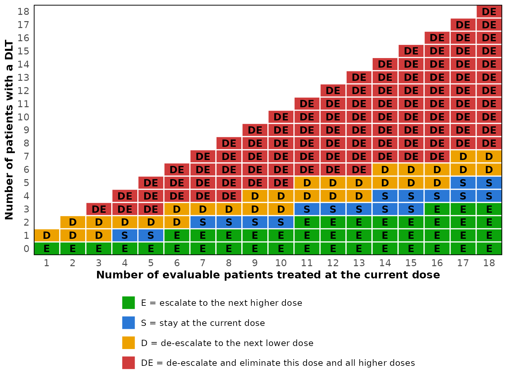
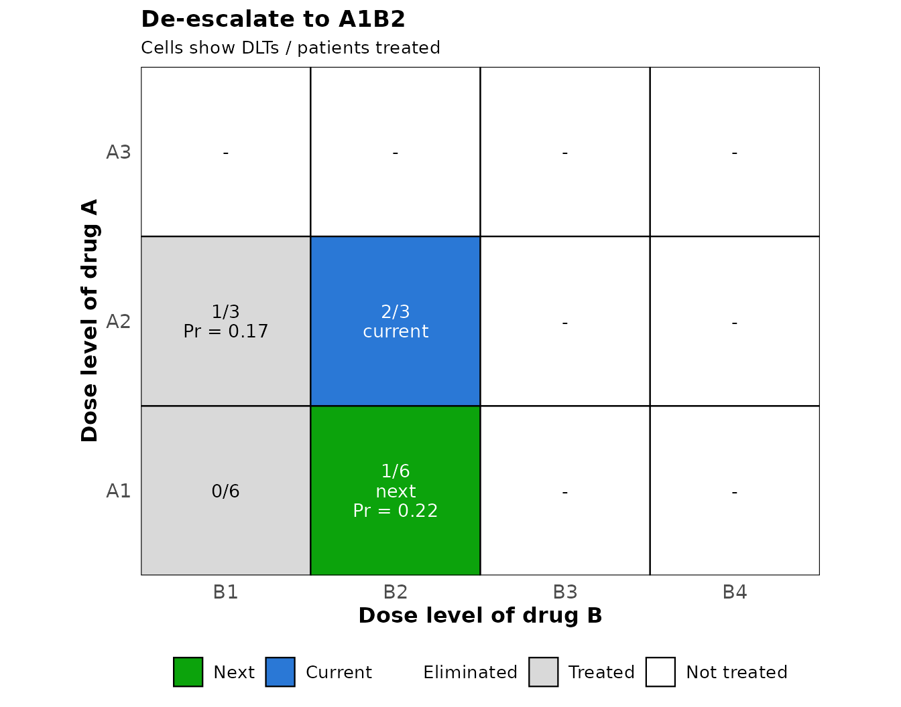

# Drug-combination trials with the BOIN design

## The design

When two drugs are given together, the doses form a matrix, with the
levels of drug A in the rows and those of drug B in the columns.
Toxicity increases along every row and every column, but two
combinations such as A3B1 (level 3 of drug A with level 1 of drug B) and
A1B3 cannot be ordered in advance, so the next cohort may go in more
than one direction. The BOIN drug-combination design of Lin and Yin
(2017) keeps the decision rule of the single-agent design and adds a
rule for the direction.

After each cohort, the observed DLT rate at the current combination is
compared with the boundaries `lambda_e` and `lambda_d` of the
single-agent design. When it calls for escalation, the next cohort goes
one level up of drug A or of drug B; when it calls for de-escalation,
one level down. Between the two candidates the design takes the one more
likely to be near the target, the one with the larger posterior
probability that its DLT rate lies between `lambda_e` and `lambda_d`. A
combination judged too toxic is eliminated together with every
combination that has at least the same level of both drugs, and the
trial stops when the lowest combination is eliminated. At the end, the
DLT rates are smoothed by bivariate isotonic regression, so that they
increase along every row and column, and the combination closest to the
target is the MTD.

The package follows the implementation in the BOIN package,
[`BOIN::get.oc.comb()`](https://rdrr.io/pkg/BOIN/man/get.oc.comb.html)
with `mtd.contour = FALSE`, so that the two can be compared trial by
trial. That implementation adds a few details to the article: a
candidate’s posterior probability is increased by 0.0005 for every
patient already treated there, so that ties go to the better informed
combination; the trial can stop at `n_earlystop`; and the MTD is
selected from the estimates `(y + 0.05) / (n + 0.1)`, with ties broken
in favor of lower combinations.

## An example

The example of Yan et al. (2020) has three levels of drug A, four of
drug B and a target DLT rate of 0.25. Two combinations, A2B2 and A3B1,
have a true DLT rate of exactly 0.25.

``` r

p_true <- matrix(c(0.02, 0.04, 0.08, 0.14,
                   0.08, 0.25, 0.42, 0.48,
                   0.25, 0.45, 0.50, 0.60), nrow = 3, byrow = TRUE)

oc <- sim_comb_boin(
  target = 0.25,
  p_true = p_true,
  n_cohort = 16,
  cohort_size = 3,
  n_earlystop = 100,
  n_trials = 1000,
  seed = 6
)
oc
#> BOIN drug-combination operating characteristics
#>   target DLT rate : 0.25
#>   dose levels     : 3 of drug A, 4 of drug B
#>   trials          : 1000
#>   cohorts         : 16 of size 3
#>   max sample size : 48
#>   lambda_e / _d   : 0.1968 / 0.2984
#> 
#>               Item Drug A   B1   B2   B3   B4
#>  True DLT rate (%)     A1  2.0  4.0  8.0 14.0
#>                        A2  8.0 25.0 42.0 48.0
#>                        A3 25.0 45.0 50.0 60.0
#>   MTD selected (%)     A1  0.0  1.1  2.8 19.8
#>                        A2  4.3 37.6  7.1  1.4
#>                        A3 21.8  3.9  0.2  0.0
#>   Patients treated     A1  4.1  3.7  3.2  4.2
#>                        A2  6.1 10.0  4.2  1.9
#>                        A3  5.9  3.6  0.8  0.3
#>  Patients with DLT     A1  0.1  0.1  0.2  0.6
#>                        A2  0.5  2.6  1.8  0.9
#>                        A3  1.5  1.6  0.4  0.2
#> 
#> No MTD selected                      : 0%
#> Average number of patients           : 48
#> Average number of DLTs               : 10.5
#> 
#> True MTD (closest to the target)     : A3B1, A2B2
#>   Selected as the MTD                : 59.4%
#>   Patients treated there             : 33.1%
#> 
#> Combinations above a true DLT rate of 0.25: 5 of 12
#>   Patients treated there             : 22.6%
#>   Trials treating any patient there  : 83.9%
#>   Trials treating over 60% there     : 5.1%
#>   Trials treating over 80% there     : 0.5%
#>   Trials selecting an MTD there      : 12.6%
```

These are the settings of the article: 16 cohorts of three, early
stopping switched off with `n_earlystop = 100`, 1,000 trials and the
seed 6, which is the default of
[`BOIN::get.oc.comb()`](https://rdrr.io/pkg/BOIN/man/get.oc.comb.html).
One of the two MTD combinations is selected in 59.4% of the trials, and
33.1% of the patients are treated at one of them, the figures printed in
the article. The package’s tests check every number of that output to
the printed precision. The average number of patients at A2B4 is exactly
1.905, half-way between two printed values, and the article prints it as
1.90 whereas R 4.6.0 prints 1.91; how such a value is rounded depends on
the version of R.

The default `n_earlystop` of the package is 18, as for the single-agent
design, whereas
[`BOIN::get.oc.comb()`](https://rdrr.io/pkg/BOIN/man/get.oc.comb.html)
defaults to 100. Set it explicitly when comparing the two.

## Comparing scenarios

[`sim_comb_boin_multi()`](https://gosukehommaex.github.io/simFastBOIN/reference/sim_comb_boin_multi.md)
runs the same design under several matrices of true DLT rates and
collects the main results in one row per scenario. Here are four of the
ten scenarios of Lin and Yin (2017), with three levels of agent 2 in the
rows and five of agent 1 in the columns, a target of 0.3 and 20 cohorts
of three.

``` r

scenarios <- list(
  "Scenario 1" = matrix(c(0.05, 0.10, 0.15, 0.30, 0.45,
                          0.10, 0.15, 0.30, 0.45, 0.55,
                          0.15, 0.30, 0.45, 0.50, 0.60), nrow = 3, byrow = TRUE),
  "Scenario 4" = matrix(c(0.30, 0.45, 0.60, 0.70, 0.80,
                          0.45, 0.55, 0.65, 0.75, 0.85,
                          0.50, 0.60, 0.70, 0.80, 0.90), nrow = 3, byrow = TRUE),
  "Scenario 8" = matrix(c(0.02, 0.10, 0.15, 0.50, 0.60,
                          0.05, 0.12, 0.30, 0.55, 0.70,
                          0.08, 0.15, 0.45, 0.60, 0.80), nrow = 3, byrow = TRUE),
  "Scenario 10" = matrix(c(0.05, 0.10, 0.15, 0.30, 0.45,
                           0.45, 0.50, 0.60, 0.65, 0.70,
                           0.70, 0.75, 0.80, 0.85, 0.90), nrow = 3, byrow = TRUE)
)

multi <- sim_comb_boin_multi(
  target = 0.30,
  scenarios = scenarios,
  n_cohort = 20,
  cohort_size = 3,
  n_earlystop = 100,
  n_trials = 2000,
  seed = 123
)
multi
#> BOIN drug-combination operating characteristics across 4 scenarios
#>   target DLT rate : 0.3
#>   dose levels     : 3 of drug A, 5 of drug B
#>   trials each     : 2000
#>   max sample size : 60
#>   overdose cutoff : 0.3
#> 
#>     Scenario         True MTD MTD selected (%) Patients at MTD (%) No MTD (%)
#>   Scenario 1 A3B2, A2B3, A1B4             70.9                43.2        0.0
#>   Scenario 4             A1B1             61.8                67.3       21.4
#>   Scenario 8             A2B3             35.4                20.4        0.0
#>  Scenario 10             A1B4             44.0                20.0        0.0
#>  Above cutoff selected (%) Patients above cutoff (%) Patients DLTs
#>                       16.0                      19.9       60 16.0
#>                       16.8                      32.7       51 18.1
#>                       20.9                      26.4       60 15.2
#>                       30.0                      38.6       60 17.3
```

“True MTD” lists the combinations closest to the target, “MTD selected”
the percentage of trials that select one of them and “Patients at MTD”
the percentage of patients treated there. The full results of a
scenario, with the selection percentage of every combination, are an
element of `multi$results`.

``` r

multi$results[["Scenario 10"]]$sel_percent
#>       B1   B2   B3    B4    B5
#> A1  2.25 3.85 19.9 43.95 10.95
#> A2 16.30 2.40  0.3  0.10  0.00
#> A3  0.00 0.00  0.0  0.00  0.00
```

In scenario 4 the lowest combination is itself the MTD, and 21.4% of the
trials stop because it is eliminated. The script
`inst/validation/compare-with-LinYin2017.R` compares these and the other
scenarios with the tables of the article.

## Design options

The options of the single-agent design carry over: `titration` treats
one patient per combination, moving up one level of either drug at
random, until the first DLT; `extrasafe` adds a stricter stopping rule
at the lowest combination; `bound_mtd` refuses an MTD whose estimate
reaches the de-escalation boundary; and `start_dose` gives the levels of
the two drugs for the first cohort.

With titration, the patients treated before the first DLT come on top of
the planned cohorts, as in the BOIN package: the first full cohort only
tops up the combination that titration reached.

## The decision table for the protocol

At the current combination the rule is that of the single-agent design,
so the decision table of
[`boin_decision_table()`](https://gosukehommaex.github.io/simFastBOIN/reference/boin_decision_table.md)
serves a drug-combination protocol as it is. Only the direction of a
move is new, and it is decided from the data when the move is made.

``` r

decisions <- boin_decision_table(target = 0.25, max_n = 18)

print(decisions, cohort_size = 3)
#>     Patients
#> DLTs 3  6  9  12 15 18
#>   0  E  E  E  E  E  E 
#>   1  D  E  E  E  E  E 
#>   2  D  D  S  E  E  E 
#>   3  DE D  D  S  S  E 
#>   4     DE D  D  S  S 
#>   5     DE DE D  D  S 
#>   6     DE DE DE D  D 
#>   7        DE DE DE D 
#>   8        DE DE DE DE
#>   9        DE DE DE DE
#>   10          DE DE DE
#>   11          DE DE DE
#>   12          DE DE DE
#>   13             DE DE
#>   14             DE DE
#>   15             DE DE
#>   16                DE
#>   17                DE
#>   18                DE
#> 
#> E = escalate, S = stay, D = de-escalate, DE = de-escalate and eliminate this dose and above
```

``` r

plot(decisions)
```



An escalation “E” moves one level up of drug A or of drug B, and a
de-escalation “D” one level down. “DE” eliminates the current
combination together with every combination that has at least the same
level of both drugs, and de-escalates; at the lowest combination it
stops the trial. Once `n_earlystop` patients have been treated at the
current combination, the trial stops unless the table calls for a move
that can be made.

## Running the trial

[`comb_boin_next()`](https://gosukehommaex.github.io/simFastBOIN/reference/comb_boin_next.md)
takes the numbers of patients and DLTs observed so far at every
combination and the combination that treated the last cohort, and
returns the combination for the next cohort. It applies the rules of the
simulations, so the trial is run with the rules whose operating
characteristics
[`sim_comb_boin()`](https://gosukehommaex.github.io/simFastBOIN/reference/sim_comb_boin.md)
reports.

``` r

n_pts <- matrix(c(6, 6, 0, 0,
                  3, 3, 0, 0,
                  0, 0, 0, 0), nrow = 3, byrow = TRUE)
n_tox <- matrix(c(0, 1, 0, 0,
                  1, 2, 0, 0,
                  0, 0, 0, 0), nrow = 3, byrow = TRUE)

nxt <- comb_boin_next(target = 0.25, n_pts = n_pts, n_tox = n_tox,
                      current = c(2, 2))
nxt
#> BOIN drug-combination design: dose for the next cohort
#>   target DLT rate : 0.25
#>   current         : A2B2, 2 DLTs out of 3 patients (0.667)
#>   boundaries      : escalate if DLTs <= 0, de-escalate if DLTs >= 1, eliminate if DLTs >= 3 (3 patients)
#> 
#> Decision: de-escalate to A1B2
#> 
#> Candidates (interval 0.1968 to 0.2984):
#>  Direction Combination Patients DLTs Pr(in interval)  Score Available
#>     drug A        A1B2        6    1           0.218 0.2211       yes
#>     drug B        A2B1        3    1           0.167 0.1687       yes
#> 
#> Eliminated combinations: none
```

Two of the three patients at A2B2 had a DLT, which reaches the
de-escalation boundary of 1 for three patients. The candidates are A1B2
and A2B1, and A1B2 has the larger posterior probability that its DLT
rate lies between `lambda_e` and `lambda_d`, 0.218 against 0.167, so it
receives the next cohort. The figure shows the same decision on the dose
matrix.

``` r

plot(nxt)
```



When the two candidates have the same score, as at the start of a trial
where neither has been treated, the design chooses between them at
random;
[`comb_boin_next()`](https://gosukehommaex.github.io/simFastBOIN/reference/comb_boin_next.md)
then returns both in `next_dose` and leaves the choice to the user. When
the trial stops, `decision` is `"stop"` and `stop_reason` says why.
After a stop for `n_earlystop`, or once the planned cohorts have been
treated,
[`comb_boin_select_mtd()`](https://gosukehommaex.github.io/simFastBOIN/reference/comb_boin_select_mtd.md)
selects the MTD from the same two matrices.

[`BOIN::next.comb()`](https://rdrr.io/pkg/BOIN/man/next.comb.html), the
corresponding function of the BOIN package, applies somewhat different
rules from the simulations of
[`BOIN::get.oc.comb()`](https://rdrr.io/pkg/BOIN/man/get.oc.comb.html):
it stops as soon as `n.earlystop` patients have been treated at the
current combination, it does not escalate drug A when a combination with
the next level of drug A and at most the current level of drug B has an
observed DLT rate at or above `lambda_d` (and likewise for drug B), and
it draws a random number to break ties.
[`comb_boin_next()`](https://gosukehommaex.github.io/simFastBOIN/reference/comb_boin_next.md)
follows the simulations instead. The tests check that it takes the
decisions of simulated trials cohort by cohort, and that it agrees with
[`BOIN::next.comb()`](https://rdrr.io/pkg/BOIN/man/next.comb.html)
wherever the rules coincide.

## Working with the trial data

[`comb_boin_simulate()`](https://gosukehommaex.github.io/simFastBOIN/reference/comb_boin_simulate.md)
returns the trials themselves, as arrays with one row per trial, and
[`comb_boin_select_mtd()`](https://gosukehommaex.github.io/simFastBOIN/reference/comb_boin_select_mtd.md)
applies the selection rule to completed trials, or to the data of a
single trial given as two matrices.

``` r

trials <- comb_boin_simulate(
  target = 0.25, p_true = p_true, n_cohort = 16, cohort_size = 3,
  n_trials = 5, seed = 1
)
trials$n_pts[1, , ]
#>    B1 B2 B3 B4
#> A1  3  6  6 18
#> A2  0  0  0  3
#> A3  0  0  0  0
trials$n_tox[1, , ]
#>    B1 B2 B3 B4
#> A1  0  0  1  1
#> A2  0  0  0  3
#> A3  0  0  0  0

comb_boin_select_mtd(trials$n_pts[1, , ], trials$n_tox[1, , ], target = 0.25)
#>   trial mtd_a mtd_b   reason
#> 1     1     1     4 selected
```

The bivariate isotonic regression is computed by
[`Iso::biviso()`](https://rdrr.io/pkg/Iso/man/biviso.html), the routine
that the BOIN package calls. This matters more than one might expect.
Combinations that the regression pools have equal estimates in exact
arithmetic, but not always in the last digits, and these digits decide
between two combinations on the same anti-diagonal. Another algorithm
for the same regression selects a different combination in a few trials
out of a thousand.

## Agreement with the BOIN package

The engine draws one uniform variate per patient, in enrollment order,
one for the direction of every titration step that can go either way,
and one for every escalation or de-escalation that has a candidate. This
is the order of
[`BOIN::get.oc.comb()`](https://rdrr.io/pkg/BOIN/man/get.oc.comb.html),
so with the same seed and matching arguments the two implementations
produce the same trials. The tests check this for several settings
whenever the BOIN package is installed, and
`inst/validation/compare-comb-with-BOIN.R` runs the comparison over a
wider grid.

``` r

reference <- BOIN::get.oc.comb(
  target = 0.25, p.true = p_true, ncohort = 16, cohortsize = 3,
  n.earlystop = 18, ntrial = 1000, seed = 6
)

ours <- sim_comb_boin(
  target = 0.25, p_true = p_true, n_cohort = 16, cohort_size = 3,
  n_earlystop = 18, n_trials = 1000, seed = 6
)

all.equal(round(unname(ours$sel_percent), 2), unname(reference$selpercent))
all.equal(round(unname(ours$n_pts_dose), 2), unname(reference$npatients))
```

The waterfall design of Zhang and Yuan (2016), which searches for the
whole MTD contour rather than a single MTD, is not provided.

## References

Lin, R. and Yin, G. (2017). Bayesian Optimal Interval Design for Dose
Finding in Drug-Combination Trials. *Statistical Methods in Medical
Research*, 26(5), 2155-2167.

Yan, F., Zhang, L., Zhou, Y., Pan, H., Liu, S. and Yuan, Y. (2020).
BOIN: An R Package for Designing Single-Agent and Drug-Combination
Dose-Finding Trials Using Bayesian Optimal Interval Designs. *Journal of
Statistical Software*, 94(13), 1-32.

Zhang, L. and Yuan, Y. (2016). A Practical Bayesian Design to Identify
the Maximum Tolerated Dose Contour for Drug Combination Trials.
*Statistics in Medicine*, 35(27), 4924-4936.
