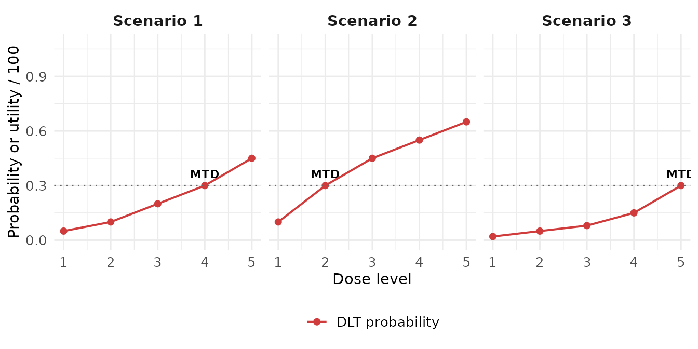
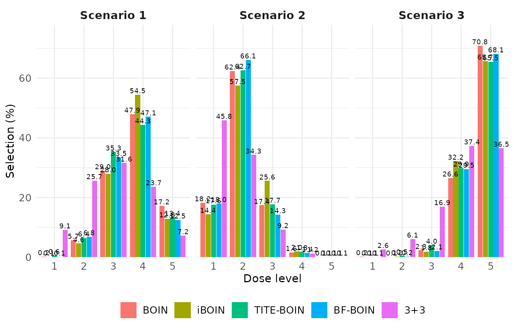
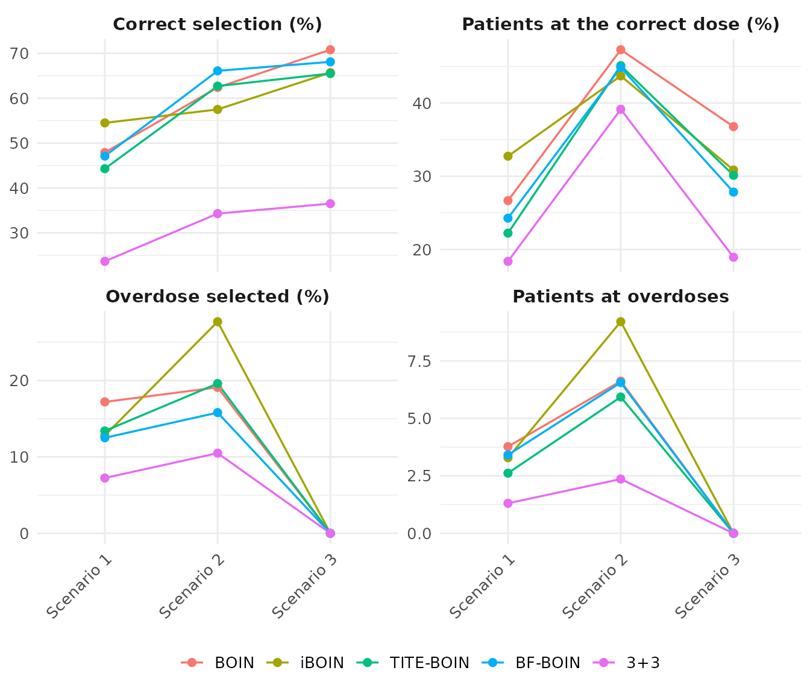
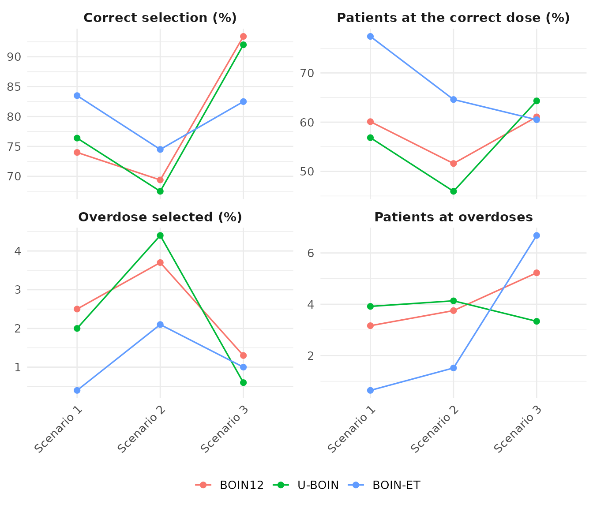
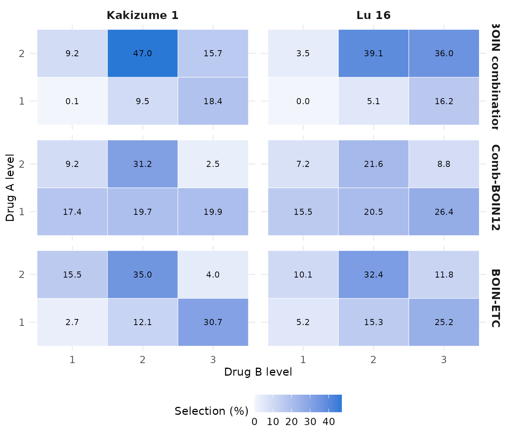
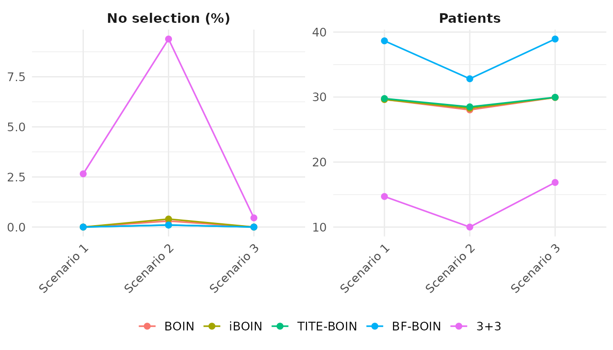

# Comparing designs and scenarios

## Three functions

A design is chosen by running the candidate designs under the same
scenarios and setting their operating characteristics side by side.
Three functions do this for every design of the package but the
waterfall design.

- [`oc_scenarios()`](https://gosukehommaex.github.io/simFastBOIN/reference/oc_scenarios.md)
  tabulates the scenarios with the true doses: the true MTD, the dose
  whose DLT rate is closest to the target, and, when the scenarios have
  response rates, the true utility of every dose and the true OBD, the
  dose with the highest utility among the doses with an acceptable DLT
  rate (and response rate).
- [`oc_results()`](https://gosukehommaex.github.io/simFastBOIN/reference/oc_results.md)
  collects the results of the simulation functions in one long data
  frame: the selection percentage and the average numbers of patients,
  DLTs and responses of every dose, and the quantities of the whole
  trial.
- [`oc_compare()`](https://gosukehommaex.github.io/simFastBOIN/reference/oc_compare.md)
  judges the same results against the true doses: how often each design
  selects the true MTD (for the designs that select an MTD) or the true
  OBD (for the designs that select an OBD), how many patients it treats
  there, how often it selects an overdose and how many patients it
  treats at overdoses, how often it selects no dose, its sample size
  and, for the designs with time, its duration.

Each design is given as the result of a simulation function for one
scenario, as the result of its `_multi` version, or as a list of results
for single scenarios named by the scenarios, which is the way to give
[`oc_3p3()`](https://gosukehommaex.github.io/simFastBOIN/reference/oc_3p3.md)
several scenarios. Nothing is simulated again: the three functions read
the summaries that the results hold. The designs must be all for a
single agent or all for a drug combination, with the same number of
doses. The waterfall design selects one combination at every level of
drug A, so that its results do not fit the summaries, which assume one
selected dose per trial;
[`vignette("simFastBOIN-combination")`](https://gosukehommaex.github.io/simFastBOIN/articles/simFastBOIN-combination.md)
describes its own summaries of the MTD contour.

## Designs that select the MTD

Three scenarios of five doses, a target DLT rate of 0.30 and 30 patients
in cohorts of three serve for the designs that look for the MTD. The
response rates are needed by BF-BOIN, which backfills patients to lower
doses that have shown a response.

``` r

scenarios <- list(
  "Scenario 1" = list(p_true = c(0.05, 0.10, 0.20, 0.30, 0.45),
                      p_resp = c(0.10, 0.20, 0.35, 0.40, 0.45)),
  "Scenario 2" = list(p_true = c(0.10, 0.30, 0.45, 0.55, 0.65),
                      p_resp = c(0.20, 0.35, 0.40, 0.45, 0.50)),
  "Scenario 3" = list(p_true = c(0.02, 0.05, 0.08, 0.15, 0.30),
                      p_resp = c(0.05, 0.10, 0.20, 0.30, 0.40))
)
truth <- oc_scenarios(lapply(scenarios, function(s) s$p_true),
                      target = 0.30)
truth
#> True scenarios: 3 scenario(s), 5 doses 
#> True MTD: DLT probability closest to 0.3 
#> 
#> Scenario 1
#>             1    2    3    4    5
#> p_true   0.05 0.10 0.20 0.30 0.45
#> true MTD                   *     
#> 
#> Scenario 2
#>             1    2    3    4    5
#> p_true   0.10 0.30 0.45 0.55 0.65
#> true MTD         *               
#> 
#> Scenario 3
#>             1    2    3    4    5
#> p_true   0.02 0.05 0.08 0.15 0.30
#> true MTD                        *
```

``` r

plot(truth)
```



The designs are BOIN, iBOIN with the skeleton of Scenario 4 of Zhou et
al. (2021), whose prior MTD is dose 4, and a prior effective sample size
of 3, TITE-BOIN and BF-BOIN with a DLT window of one month and two
patients a month, and the 3+3 design, whose operating characteristics
are computed in closed form. Every simulated design uses the same seed.

``` r

design <- list(target = 0.30, scenarios = scenarios, n_cohort = 10,
               cohort_size = 3, n_trials = 1000, seed = 123)
timing <- list(window = 1, accrual_rate = 2)

boin <- do.call(sim_boin_multi, design)
iboin <- do.call(sim_iboin_multi,
                 c(design, list(skeleton = c(0.04, 0.10, 0.19, 0.30, 0.42),
                                prior_ess = 3)))
tite <- do.call(sim_tite_boin_multi, c(design, timing))
bf <- do.call(sim_bf_boin_multi, c(design, timing))
three <- lapply(scenarios, function(s) oc_3p3(p_true = s$p_true))
```

[`oc_results()`](https://gosukehommaex.github.io/simFastBOIN/reference/oc_results.md)
sets the selection and the allocation of every dose side by side, and
its [`plot()`](https://rdrr.io/r/graphics/plot.default.html) method
draws the selection.

``` r

results <- oc_results(BOIN = boin, iBOIN = iboin, "TITE-BOIN" = tite,
                      "BF-BOIN" = bf, "3+3" = three)
results
#> Operating characteristics of 5 design(s) in 3 scenario(s)
#> 
#> Scenario 1
#> Selection (%) by dose
#>             1    2    3    4    5
#> BOIN      0.2  5.7 29.0 47.9 17.2
#> iBOIN     0.1  4.6 28.0 54.5 12.8
#> TITE-BOIN 0.6  6.4 35.3 44.3 13.4
#> BF-BOIN   0.1  6.8 33.5 47.1 12.5
#> 3+3       9.1 25.7 31.6 23.7  7.2
#> Patients by dose
#>             1   2    3   4   5
#> BOIN      3.7 5.6  8.6 7.9 3.8
#> iBOIN     3.2 4.6  8.8 9.7 3.3
#> TITE-BOIN 4.4 7.0  9.2 6.6 2.6
#> BF-BOIN   5.0 8.9 11.9 9.4 3.4
#> 3+3       3.4 3.6  3.7 2.7 1.3
#> Per trial (averages)
#>           No selection (%) Patients DLTs Responses Duration
#> BOIN                   0.0     29.6  6.6         -        -
#> iBOIN                  0.0     29.6  6.9         -        -
#> TITE-BOIN              0.0     29.8  6.0         -     16.3
#> BF-BOIN                0.0     38.6  7.9      11.7     21.9
#> 3+3                    2.7     14.7  2.7         -        -
#> 
#> Scenario 2
#> Selection (%) by dose
#>              1    2    3   4   5
#> BOIN      18.2 62.4 17.4 1.6 0.1
#> iBOIN     14.4 57.5 25.6 2.0 0.1
#> TITE-BOIN 17.6 62.7 17.7 1.8 0.1
#> BF-BOIN   18.0 66.1 14.3 1.4 0.1
#> 3+3       45.8 34.3  9.2 1.2 0.1
#> Patients by dose
#>              1    2   3   4   5
#> BOIN       8.2 13.3 5.7 0.9 0.1
#> iBOIN      6.7 12.4 7.7 1.4 0.1
#> TITE-BOIN  9.7 12.9 5.0 0.9 0.1
#> BF-BOIN   11.5 14.7 5.6 0.9 0.1
#> 3+3        3.7  3.9 1.9 0.4 0.0
#> Per trial (averages)
#>           No selection (%) Patients DLTs Responses Duration
#> BOIN                   0.3     28.0  8.0         -        -
#> iBOIN                  0.4     28.3  8.8         -        -
#> TITE-BOIN              0.1     28.5  7.7         -     15.3
#> BF-BOIN                0.1     32.8  8.6      10.2     19.5
#> 3+3                    9.4     10.0  2.7         -        -
#> 
#> Scenario 3
#> Selection (%) by dose
#>             1   2    3    4    5
#> BOIN      0.2 0.1  2.3 26.6 70.8
#> iBOIN     0.1 0.2  1.8 32.2 65.7
#> TITE-BOIN 0.1 0.5  4.0 29.9 65.5
#> BF-BOIN   0.1 0.2  2.1 29.5 68.1
#> 3+3       2.6 6.1 16.9 37.4 36.5
#> Patients by dose
#>             1   2   3    4    5
#> BOIN      3.2 3.6 4.6  7.5 11.0
#> iBOIN     3.0 3.2 4.6 10.0  9.2
#> TITE-BOIN 3.6 4.3 5.4  7.7  9.0
#> BF-BOIN   3.6 5.0 7.9 11.6 10.8
#> 3+3       3.2 3.4 3.5  3.6  3.2
#> Per trial (averages)
#>           No selection (%) Patients DLTs Responses Duration
#> BOIN                   0.0     29.9  5.1         -        -
#> iBOIN                  0.0     29.9  4.9         -        -
#> TITE-BOIN              0.0     30.0  4.6         -     16.6
#> BF-BOIN                0.0     38.9  6.0      10.1     22.2
#> 3+3                    0.5     16.9  2.0         -        -
```

``` r

plot(results)
```



[`oc_compare()`](https://gosukehommaex.github.io/simFastBOIN/reference/oc_compare.md)
judges the same results against `truth`. An overdose is a dose with a
DLT rate above the target, the `tox_limit` of `truth`.

``` r

comparison <- oc_compare(BOIN = boin, iBOIN = iboin, "TITE-BOIN" = tite,
                         "BF-BOIN" = bf, "3+3" = three, truth = truth)
comparison
#> Comparison of 5 design(s) with the true doses
#> Correct: the true MTD for designs selecting an MTD, the true OBD for designs selecting an OBD
#> Overdose: true DLT probability above 0.3 
#> 
#> Scenario 1
#>                 Correct (%) Pts at correct (%) Overdose sel. (%)
#> BOIN (MTD)             47.9               26.7              17.2
#> iBOIN (MTD)            54.5               32.7              12.8
#> TITE-BOIN (MTD)        44.3               22.2              13.4
#> BF-BOIN (MTD)          47.1               24.3              12.5
#> 3+3 (MTD)              23.7               18.4               7.2
#>                 Pts at overdose No selection (%) Patients Duration
#> BOIN (MTD)                  3.8              0.0     29.6        -
#> iBOIN (MTD)                 3.3              0.0     29.6        -
#> TITE-BOIN (MTD)             2.6              0.0     29.8     16.3
#> BF-BOIN (MTD)               3.4              0.0     38.6     21.9
#> 3+3 (MTD)                   1.3              2.7     14.7        -
#> 
#> Scenario 2
#>                 Correct (%) Pts at correct (%) Overdose sel. (%)
#> BOIN (MTD)             62.4               47.3              19.1
#> iBOIN (MTD)            57.5               43.7              27.7
#> TITE-BOIN (MTD)        62.7               45.1              19.6
#> BF-BOIN (MTD)          66.1               44.9              15.8
#> 3+3 (MTD)              34.3               39.1              10.5
#>                 Pts at overdose No selection (%) Patients Duration
#> BOIN (MTD)                  6.6              0.3     28.0        -
#> iBOIN (MTD)                 9.2              0.4     28.3        -
#> TITE-BOIN (MTD)             5.9              0.1     28.5     15.3
#> BF-BOIN (MTD)               6.6              0.1     32.8     19.5
#> 3+3 (MTD)                   2.4              9.4     10.0        -
#> 
#> Scenario 3
#>                 Correct (%) Pts at correct (%) Overdose sel. (%)
#> BOIN (MTD)             70.8               36.8               0.0
#> iBOIN (MTD)            65.7               30.9               0.0
#> TITE-BOIN (MTD)        65.5               30.1               0.0
#> BF-BOIN (MTD)          68.1               27.8               0.0
#> 3+3 (MTD)              36.5               18.9               0.0
#>                 Pts at overdose No selection (%) Patients Duration
#> BOIN (MTD)                  0.0              0.0     29.9        -
#> iBOIN (MTD)                 0.0              0.0     29.9        -
#> TITE-BOIN (MTD)             0.0              0.0     30.0     16.6
#> BF-BOIN (MTD)               0.0              0.0     38.9     22.2
#> 3+3 (MTD)                   0.0              0.5     16.9        -
```

``` r

plot(comparison)
```



The skeleton puts the prior MTD at the true MTD of Scenario 1, which
iBOIN selects in 54.5 percent of the trials and BOIN in 47.9 percent; in
Scenarios 2 and 3 the prior MTD is not the true MTD, and the percentages
are 57.5 and 65.7 for iBOIN against 62.4 and 70.8 for BOIN. In Scenario
1, TITE-BOIN lasts 16.3 months on average and BF-BOIN 21.9 months;
BF-BOIN treats 38.6 patients on average, the backfilled ones included,
against 29.6 for BOIN. The designs without time have no duration.

## Scores in the place of DLT rates: gBOIN and gBOIN-ET

The results of gBOIN and gBOIN-ET hold the true mean normalized scores
of the doses in the place of the DLT and response rates, and
[`oc_compare()`](https://gosukehommaex.github.io/simFastBOIN/reference/oc_compare.md)
checks that the results agree with `truth`. Their truth is therefore
built from these scores, and they are compared with designs on the same
scores, for example the two elimination rules of gBOIN in Scenarios 1
and 7 of Mu et al. (2019), with the equivalent toxicity scores 0, 0.5, 1
and 1.5 and a target score of 0.47.

``` r

grade_scenarios <- list(
  "Scenario 1" = rbind(c(0.83, 0.75, 0.62, 0.51, 0.34, 0.19),
                       c(0.12, 0.15, 0.18, 0.19, 0.16, 0.11),
                       c(0.04, 0.07, 0.11, 0.14, 0.15, 0.11),
                       c(0.01, 0.03, 0.09, 0.16, 0.35, 0.59)),
  "Scenario 7" = rbind(c(0.78, 0.58, 0.50, 0.40, 0.30, 0.16),
                       c(0.14, 0.18, 0.18, 0.17, 0.15, 0.09),
                       c(0.00, 0.00, 0.00, 0.00, 0.00, 0.00),
                       c(0.08, 0.24, 0.32, 0.43, 0.55, 0.75))
)
grade_design <- list(target = 0.47 / 1.5, scenarios = grade_scenarios,
                     score = c(0, 0.5, 1, 1.5), n_cohort = 10,
                     cohort_size = 3, n_earlystop = 100, n_trials = 1000,
                     seed = 123)
posterior <- do.call(sim_gboin_multi, grade_design)
count <- do.call(sim_gboin_multi, c(grade_design, list(elim_rule = "count")))

truth_grade <- oc_scenarios(lapply(posterior$results,
                                   function(r) r$p_true),
                            target = 0.47 / 1.5, tox_limit = 0.35)
oc_compare("gBOIN, posterior" = posterior, "gBOIN, count" = count,
           truth = truth_grade)
#> Comparison of 2 design(s) with the true doses
#> Correct: the true MTD for designs selecting an MTD, the true OBD for designs selecting an OBD
#> Overdose: true DLT probability above 0.35 
#> 
#> Scenario 1
#>                        Correct (%) Pts at correct (%) Overdose sel. (%)
#> gBOIN, posterior (MTD)        53.0               28.5              10.7
#> gBOIN, count (MTD)            53.6               28.9              11.2
#>                        Pts at overdose No selection (%) Patients
#> gBOIN, posterior (MTD)             3.0              0.1     30.0
#> gBOIN, count (MTD)                 3.2              0.0     30.0
#> 
#> Scenario 7
#>                        Correct (%) Pts at correct (%) Overdose sel. (%)
#> gBOIN, posterior (MTD)        51.4               41.9              32.7
#> gBOIN, count (MTD)            56.9               43.4              32.0
#>                        Pts at overdose No selection (%) Patients
#> gBOIN, posterior (MTD)             8.3              0.4     29.9
#> gBOIN, count (MTD)                 8.1              0.1     30.0
```

The true MTD of Scenario 1, dose 4, has an equivalent toxicity score of
0.475, just above the target, so that an overdose is taken here to be a
dose with a normalized score above 0.35 (`tox_limit`) rather than above
the target.

The utility of
[`oc_scenarios()`](https://gosukehommaex.github.io/simFastBOIN/reference/oc_scenarios.md)
is that of a binary DLT and a binary response, so for gBOIN-ET the true
OBD is better given directly, through `true_obd`. Scenario 3 of Takeda
et al. (2023) has the toxicity of Scenario 1 above, four efficacy
categories scored 0, 0.25, 1 and 3 with a target efficacy score of 1.75,
and dose 4 as the optimal dose of the article. gBOIN-ET and
TITE-gBOIN-ET, the latter with windows of 30 and 60 days and one patient
every 10 days, are compared on the same scores:

``` r

g_design <- list(target = 0.47 / 1.5, target_resp = 1.75 / 3,
                 p_grade = grade_scenarios[["Scenario 1"]],
                 p_resp_grade = rbind(c(0.60, 0.50, 0.30, 0.15, 0.10, 0.05),
                                      c(0.30, 0.20, 0.20, 0.15, 0.15, 0.15),
                                      c(0.05, 0.20, 0.35, 0.20, 0.20, 0.20),
                                      c(0.05, 0.10, 0.15, 0.50, 0.55, 0.60)),
                 score = c(0, 0.5, 1, 1.5), score_resp = c(0, 0.25, 1, 3),
                 n_cohort = 12, cohort_size = 3, n_trials = 1000,
                 seed = 123)
g_et <- do.call(sim_gboin_et, g_design)
g_tite <- do.call(sim_tite_gboin_et,
                  c(g_design, list(window = 30, resp_window = 60,
                                   accrual_rate = 1 / 10)))

truth_g <- oc_scenarios(
  list("Scenario 3" = list(p_true = g_et$p_true, p_resp = g_et$p_resp)),
  target = 0.47 / 1.5, tox_limit = 0.35, true_obd = list("Scenario 3" = 4)
)
oc_compare("gBOIN-ET" = list("Scenario 3" = g_et),
           "TITE-gBOIN-ET" = list("Scenario 3" = g_tite), truth = truth_g)
#> Comparison of 2 design(s) with the true doses
#> Correct: the true MTD for designs selecting an MTD, the true OBD for designs selecting an OBD
#> Overdose: true DLT probability above 0.35 
#> 
#> Scenario 3
#>                     Correct (%) Pts at correct (%) Overdose sel. (%)
#> gBOIN-ET (OBD)             65.6               44.0               2.7
#> TITE-gBOIN-ET (OBD)        60.8               39.4               5.2
#>                     Pts at overdose No selection (%) Patients Duration
#> gBOIN-ET (OBD)                  2.2              0.2     36.0        -
#> TITE-gBOIN-ET (OBD)             3.5              0.2     36.0    518.2
```

A result for a single scenario is given as a list named by the scenario,
so that its name matches that of `truth`; given alone it would be named
“Scenario 1”. The duration of TITE-gBOIN-ET is in days.

## Designs that select the OBD

Scenarios 1 to 3 of Simulation A of Zhou, Lee and Yuan (2019) have a DLT
limit of 0.30, a response limit of 0.20 and 54 patients in cohorts of
three. The utilities 0, 30, 50 and 100 of (no response, DLT), (no
response, no DLT), (response, DLT) and (response, no DLT), the default
of U-BOIN, are those of `psi00 = 30` and `psi11 = 50` for BOIN12 and
[`oc_scenarios()`](https://gosukehommaex.github.io/simFastBOIN/reference/oc_scenarios.md),
so that the true OBD is the same for every design; the DLT and the
response of a patient are independent here. BOIN-ET needs the response
rate that it aims at, set to 0.50.

``` r

obd_scenarios <- list(
  "Scenario 1" = list(p_true = c(0.02, 0.15, 0.30, 0.45, 0.60),
                      p_resp = c(0.20, 0.65, 0.65, 0.65, 0.65)),
  "Scenario 2" = list(p_true = c(0.03, 0.08, 0.15, 0.28, 0.40),
                      p_resp = c(0.10, 0.22, 0.60, 0.60, 0.60)),
  "Scenario 3" = list(p_true = c(0.05, 0.15, 0.30, 0.45, 0.60),
                      p_resp = c(0.08, 0.46, 0.25, 0.20, 0.10))
)
truth_obd <- oc_scenarios(obd_scenarios, target = 0.30, target_resp = 0.20,
                          psi00 = 30, psi11 = 50)
truth_obd
#> True scenarios: 3 scenario(s), 5 doses 
#> True MTD: DLT probability closest to 0.3 
#> True OBD: highest utility among the doses with DLT probability <= 0.3 and response probability >= 0.2 
#> Utilities: 100 (response, no DLT), 30 (neither), 50 (both), 0 (DLT, no response)
#> 
#> Scenario 1
#>             1    2    3    4    5
#> p_true   0.02 0.15 0.30 0.45 0.60
#> p_resp   0.20 0.65 0.65 0.65 0.65
#> utility  43.3 69.0 62.6 56.2 49.7
#> true MTD              *          
#> true OBD         *               
#> 
#> Scenario 2
#>             1    2    3    4    5
#> p_true   0.03 0.08 0.15 0.28 0.40
#> p_resp   0.10 0.22 0.60 0.60 0.60
#> utility  36.0 42.6 65.7 60.2 55.2
#> true MTD                   *     
#> true OBD              *          
#> 
#> Scenario 3
#>             1    2    3    4    5
#> p_true   0.05 0.15 0.30 0.45 0.60
#> p_resp   0.08 0.46 0.25 0.20 0.10
#> utility  34.0 56.3 37.0 28.7 17.8
#> true MTD              *          
#> true OBD         *

obd_design <- list(scenarios = obd_scenarios, n_cohort = 18,
                   cohort_size = 3, n_trials = 1000, seed = 123)
boin12 <- do.call(sim_boin12_multi,
                  c(obd_design, list(target = 0.30, target_resp = 0.20,
                                     psi00 = 30, psi11 = 50)))
uboin <- do.call(sim_uboin_multi,
                 c(obd_design, list(tox_upper = 0.30, resp_lower = 0.20)))
boin_et <- do.call(sim_boin_et_multi,
                   c(obd_design, list(target = 0.30, target_resp = 0.50,
                                      resp_cor = 0)))

comparison_obd <- oc_compare(BOIN12 = boin12, "U-BOIN" = uboin,
                             "BOIN-ET" = boin_et, truth = truth_obd)
comparison_obd
#> Comparison of 3 design(s) with the true doses
#> Correct: the true MTD for designs selecting an MTD, the true OBD for designs selecting an OBD
#> Overdose: true DLT probability above 0.3 
#> 
#> Scenario 1
#>               Correct (%) Pts at correct (%) Overdose sel. (%) Pts at overdose
#> BOIN12 (OBD)         74.0               60.1               2.5             3.2
#> U-BOIN (OBD)         76.4               56.8               2.0             3.9
#> BOIN-ET (OBD)        83.5               77.4               0.4             0.6
#>               No selection (%) Patients
#> BOIN12 (OBD)               0.1     54.0
#> U-BOIN (OBD)               0.1     54.0
#> BOIN-ET (OBD)              0.4     53.9
#> 
#> Scenario 2
#>               Correct (%) Pts at correct (%) Overdose sel. (%) Pts at overdose
#> BOIN12 (OBD)         69.4               51.6               3.7             3.8
#> U-BOIN (OBD)         67.5               45.9               4.4             4.1
#> BOIN-ET (OBD)        74.5               64.6               2.1             1.5
#>               No selection (%) Patients
#> BOIN12 (OBD)               0.1     54.0
#> U-BOIN (OBD)               0.4     53.9
#> BOIN-ET (OBD)              0.0     54.0
#> 
#> Scenario 3
#>               Correct (%) Pts at correct (%) Overdose sel. (%) Pts at overdose
#> BOIN12 (OBD)         93.4               61.1               1.3             5.2
#> U-BOIN (OBD)         92.0               64.3               0.6             3.3
#> BOIN-ET (OBD)        82.5               60.5               1.0             6.7
#>               No selection (%) Patients
#> BOIN12 (OBD)               0.9     53.7
#> U-BOIN (OBD)               1.7     53.5
#> BOIN-ET (OBD)              1.2     53.7
```

``` r

plot(comparison_obd)
```



In Scenario 3 the response rate peaks at dose 2, the true OBD, which
BOIN12 selects in 93.4 percent of the trials, U-BOIN in 92 percent and
BOIN-ET in 82.5 percent. Designs that select an MTD and designs that
select an OBD can be judged in the same table; each is judged against
its own true dose, as the column of the design type in the printed table
shows.

## Drug combinations

For two drugs given together the scenarios hold matrices, with one row
per level of drug A and one column per level of drug B. Scenario 1 of
Kakizume et al. (2024) and Scenario 16 of Lu et al. (2025) have two
levels of drug A and three of drug B; the target DLT rate is 0.30, the
lowest acceptable response rate 0.20 and the trials have 24 patients in
cohorts of three. The BOIN drug-combination design selects an MTD
combination, and Comb-BOIN12 and BOIN-ETC an optimal dose combination;
BOIN-ETC aims at a response rate of 0.60.

``` r

comb_scenarios <- list(
  "Kakizume 1" = list(
    p_true = matrix(c(0.05, 0.10, 0.10, 0.30, 0.30, 0.50), nrow = 2),
    p_resp = matrix(c(0.10, 0.25, 0.25, 0.60, 0.60, 0.65), nrow = 2)
  ),
  "Lu 16" = list(
    p_true = matrix(c(0.05, 0.10, 0.15, 0.15, 0.20, 0.45), nrow = 2),
    p_resp = matrix(c(0.10, 0.20, 0.30, 0.40, 0.50, 0.60), nrow = 2)
  )
)
truth_comb <- oc_scenarios(comb_scenarios, target = 0.30, target_resp = 0.20)
truth_comb
#> True scenarios: 2 scenario(s), 2 x 3 combinations 
#> True MTD: DLT probability closest to 0.3 
#> True OBD: highest utility among the doses with DLT probability <= 0.3 and response probability >= 0.2 
#> Utilities: 100 (response, no DLT), 40 (neither), 60 (both), 0 (DLT, no response)
#> 
#> Kakizume 1
#> DLT probability (* true MTD)
#>       B1    B2    B3
#> A1 0.05  0.10  0.30*
#> A2 0.10  0.30* 0.50 
#> Response probability
#>       B1    B2    B3
#> A1 0.10  0.25  0.60 
#> A2 0.25  0.60  0.65 
#> Utility (* true OBD)
#>       B1    B2    B3
#> A1 44.0  51.0  64.0*
#> A2 51.0  64.0* 59.0 
#> 
#> Lu 16
#> DLT probability (* true MTD)
#>       B1    B2    B3
#> A1 0.05  0.15  0.20*
#> A2 0.10  0.15  0.45 
#> Response probability
#>       B1    B2    B3
#> A1 0.10  0.30  0.50 
#> A2 0.20  0.40  0.60 
#> Utility (* true OBD)
#>       B1    B2    B3
#> A1 44.0  52.0  62.0*
#> A2 48.0  58.0  58.0

comb_design <- list(target = 0.30, scenarios = comb_scenarios, n_cohort = 8,
                    cohort_size = 3, n_trials = 1000, seed = 123)
comb <- do.call(sim_comb_boin_multi, comb_design)
comb12 <- do.call(sim_comb_boin12_multi,
                  c(comb_design, list(target_resp = 0.20)))
etc <- do.call(sim_boin_etc_multi, c(comb_design, list(target_resp = 0.60)))

oc_compare("BOIN combination" = comb, "Comb-BOIN12" = comb12,
           "BOIN-ETC" = etc, truth = truth_comb)
#> Comparison of 3 design(s) with the true doses
#> Correct: the true MTD for designs selecting an MTD, the true OBD for designs selecting an OBD
#> Overdose: true DLT probability above 0.3 
#> 
#> Kakizume 1
#>                        Correct (%) Pts at correct (%) Overdose sel. (%)
#> BOIN combination (MTD)        65.4               41.1              15.7
#> Comb-BOIN12 (OBD)             51.1               47.8               2.5
#> BOIN-ETC (OBD)                65.7               41.7               4.0
#>                        Pts at overdose No selection (%) Patients
#> BOIN combination (MTD)             4.0              0.1     24.0
#> Comb-BOIN12 (OBD)                  1.9              0.1     24.0
#> BOIN-ETC (OBD)                     1.3              0.0     22.3
#> 
#> Lu 16
#>                        Correct (%) Pts at correct (%) Overdose sel. (%)
#> BOIN combination (MTD)        16.2                9.3              36.0
#> Comb-BOIN12 (OBD)             26.4               21.3               8.8
#> BOIN-ETC (OBD)                25.2               16.1              11.8
#>                        Pts at overdose No selection (%) Patients
#> BOIN combination (MTD)             6.5              0.1     24.0
#> Comb-BOIN12 (OBD)                  3.9              0.0     24.0
#> BOIN-ETC (OBD)                     3.2              0.0     22.7
```

For a combination, the
[`plot()`](https://rdrr.io/r/graphics/plot.default.html) method of
[`oc_results()`](https://gosukehommaex.github.io/simFastBOIN/reference/oc_results.md)
draws one matrix of tiles for every design and scenario.

``` r

plot(oc_results("BOIN combination" = comb, "Comb-BOIN12" = comb12,
                "BOIN-ETC" = etc))
```



## Working with the tables

The three results are data frames, so that they can be subset, reshaped
and written to a file like any other; their
[`print()`](https://rdrr.io/r/base/print.html) methods only lay them
out. [`print()`](https://rdrr.io/r/base/print.html) of
[`oc_results()`](https://gosukehommaex.github.io/simFastBOIN/reference/oc_results.md)
takes the per-dose quantities to show, and the
[`plot()`](https://rdrr.io/r/graphics/plot.default.html) methods take
the quantity or the columns to draw.

``` r

print(results[results$scenario == "Scenario 2", ],
      metric = c("sel_percent", "n_tox"))
#> Operating characteristics of 5 design(s) in 1 scenario(s)
#> 
#> Scenario 2
#> Selection (%) by dose
#>              1    2    3   4   5
#> BOIN      18.2 62.4 17.4 1.6 0.1
#> iBOIN     14.4 57.5 25.6 2.0 0.1
#> TITE-BOIN 17.6 62.7 17.7 1.8 0.1
#> BF-BOIN   18.0 66.1 14.3 1.4 0.1
#> 3+3       45.8 34.3  9.2 1.2 0.1
#> DLTs by dose
#>             1   2   3   4   5
#> BOIN      0.8 4.0 2.6 0.5 0.0
#> iBOIN     0.6 3.8 3.5 0.8 0.1
#> TITE-BOIN 1.0 3.9 2.2 0.5 0.1
#> BF-BOIN   1.2 4.4 2.5 0.5 0.1
#> 3+3       0.4 1.2 0.9 0.2 0.0
#> Per trial (averages)
#>           No selection (%) Patients DLTs Responses Duration
#> BOIN                   0.3     28.0  8.0         -        -
#> iBOIN                  0.4     28.3  8.8         -        -
#> TITE-BOIN              0.1     28.5  7.7         -     15.3
#> BF-BOIN                0.1     32.8  8.6      10.2     19.5
#> 3+3                    9.4     10.0  2.7         -        -
```

``` r

plot(comparison, metrics = c("pct_no_selection", "total_n_pts"))
```



Three arguments change the definitions. `tox_limit` of
[`oc_scenarios()`](https://gosukehommaex.github.io/simFastBOIN/reference/oc_scenarios.md)
sets the highest acceptable DLT rate of the true OBD, and with it the
overdoses, which `overdose_cutoff` of
[`oc_compare()`](https://gosukehommaex.github.io/simFastBOIN/reference/oc_compare.md)
sets on its own. `true_mtd` and `true_obd` give the true doses directly
when an article defines them otherwise, for example Lin et al. (2020),
who count every dose within 3 points of the highest utility as an OBD.

## References

Kakizume, T., Takeda, K., Taguri, M. and Morita, S. (2024). BOIN-ETC: A
Bayesian optimal interval design considering efficacy and toxicity to
identify the optimal dose combinations. *Statistical Methods in Medical
Research*, 33(4), 716-727.

Lin, R., Zhou, Y., Yan, F., Li, D. and Yuan, Y. (2020). BOIN12: Bayesian
optimal interval phase I/II trial design for utility-based dose finding
in immunotherapy and targeted therapies. *JCO Precision Oncology*, 4,
1393-1402.

Lu, M., Zhang, J., Yuan, Y. and Lin, R. (2025). Comb-BOIN12: A
utility-based Bayesian optimal interval design for dose optimization in
cancer drug-combination trials. *Statistics in Biopharmaceutical
Research*, 17(2), 266-276.

Mu, R., Yuan, Y., Xu, J., Mandrekar, S. J. and Yin, J. (2019). gBOIN: a
unified model-assisted phase I trial design accounting for toxicity
grades, and binary or continuous end points. *Journal of the Royal
Statistical Society: Series C*, 68, 289-308.

Takeda, K., Yamaguchi, Y., Taguri, M. and Morita, S. (2023).
TITE-gBOIN-ET: Time-to-event generalized Bayesian optimal interval
design to accelerate dose-finding accounting for ordinal graded efficacy
and toxicity outcomes. *Biometrical Journal*, 65(7), 2200265.

Zhou, Y., Lee, J. J. and Yuan, Y. (2019). A utility-based Bayesian
optimal interval (U-BOIN) phase I/II design to identify the optimal
biological dose for targeted and immune therapies. *Statistics in
Medicine*, 38(28), S5299-S5316.

Zhou, Y., Lee, J. J., Wang, S., Bailey, S. and Yuan, Y. (2021).
Incorporating historical information to improve phase I clinical trials.
*Pharmaceutical Statistics*, 20, 1017-1034.
