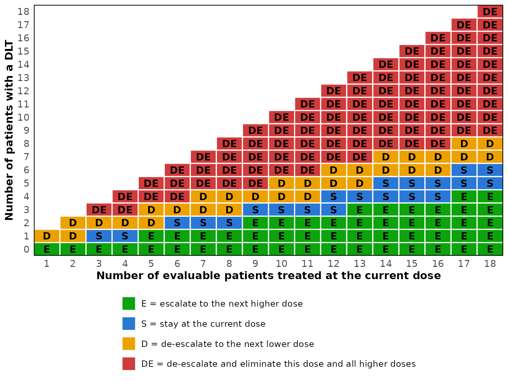

# Getting started with simFastBOIN

## What the package does

The Bayesian optimal interval (BOIN) design assigns a cohort of patients
to a dose, counts how many experienced a dose-limiting toxicity, and
compares the observed rate against two boundaries. If the rate is at or
below the lower boundary the next cohort is escalated, if it reaches the
upper boundary the next cohort is de-escalated, and otherwise the dose
is repeated. The rule is as simple to run as a 3+3 design, and Liu and
Yuan report average performance comparable to that of the continual
reassessment method.

This package provides the boundaries, a fast simulation engine for
operating characteristics, and the MTD selection rule applied at the end
of a trial. The traditional 3+3 design is included as a comparator, so
the two can be tabulated side by side. For toxicity that appears late in
the assessment window, the time-to-event version of the design has a
vignette of its own,
[`vignette("simFastBOIN-tite")`](https://gosukehommaex.github.io/simFastBOIN/articles/simFastBOIN-tite.md),
and so do the designs that backfill patients to lower doses while the
escalation waits,
[`vignette("simFastBOIN-backfill")`](https://gosukehommaex.github.io/simFastBOIN/articles/simFastBOIN-backfill.md),
and the design for trials of two drugs given together,
[`vignette("simFastBOIN-combination")`](https://gosukehommaex.github.io/simFastBOIN/articles/simFastBOIN-combination.md).

## Decision boundaries

[`boin_lambda()`](https://gosukehommaex.github.io/simFastBOIN/reference/boin_lambda.md)
returns the two interval boundaries, which depend only on the target
rate and the two thresholds around it.

``` r

boin_lambda(target = 0.30)
#> $lambda_e
#> [1] 0.2364907
#> 
#> $lambda_d
#> [1] 0.3585195
```

In practice the boundaries are used as whole numbers of toxicities.
[`boin_boundary()`](https://gosukehommaex.github.io/simFastBOIN/reference/boin_boundary.md)
tabulates them, together with the elimination boundary, for every
attainable sample size at a dose.

``` r

bd <- boin_boundary(target = 0.30, max_n = 18, extrasafe = TRUE)
print(bd, cohort_size = 3)
#> BOIN decision boundaries
#>   target DLT rate : 0.3
#>   p_saf / p_tox   : 0.18 / 0.42
#>   lambda_e        : 0.2365
#>   lambda_d        : 0.3585
#>   cutoff_eli      : 0.95
#>   safety cutoff   : 0.9
#> 
#>                                                  
#> Number of patients treated         3 6 9 12 15 18
#> Escalate if # of DLT <=            0 1 2  2  3  4
#> Deescalate if # of DLT >=          2 3 4  5  6  7
#> Eliminate if # of DLT >=           3 4 5  7  8  9
#> Stop at lowest dose if # of DLT >= 2 4 5  6  7  8
```

Reading the first column: with three patients treated, escalate on zero
toxicities, de-escalate on two or more, and stay on exactly one.

The same information can be read as a table indexed by both counts.
Printing it with a cohort size shows only the sample sizes that are
actually reached.

``` r

decisions <- boin_decision_table(target = 0.30, max_n = 18)

print(decisions, cohort_size = 3)
#>     Patients
#> DLTs 3  6  9  12 15 18
#>   0  E  E  E  E  E  E 
#>   1  S  E  E  E  E  E 
#>   2  D  S  E  E  E  E 
#>   3  DE D  S  S  E  E 
#>   4     DE D  S  S  E 
#>   5     DE DE D  S  S 
#>   6     DE DE D  D  S 
#>   7        DE DE D  D 
#>   8        DE DE DE D 
#>   9        DE DE DE DE
#>   10          DE DE DE
#>   11          DE DE DE
#>   12          DE DE DE
#>   13             DE DE
#>   14             DE DE
#>   15             DE DE
#>   16                DE
#>   17                DE
#>   18                DE
#> 
#> E = escalate, S = stay, D = de-escalate, DE = de-escalate and eliminate this dose and above
```

For a protocol the table is usually easier to read as a picture. Every
cell carries its decision letter, so the figure survives grayscale
printing.

``` r

plot(decisions)
```



When `extrasafe = TRUE` there is a second, stricter rule that applies at
the lowest dose only.
[`boin_stopping_table()`](https://gosukehommaex.github.io/simFastBOIN/reference/boin_stopping_table.md)
lays it out the same way.

``` r

boin_stopping_table(bd, cohort_size = 3)
#>                                                               3 6 9 12 15 18
#> Number of evaluable patients treated at the lowest dose level 3 6 9 12 15 18
#> Stop the trial if # of DLT >=                                 2 4 5  6  7  8
```

## Operating characteristics for one scenario

[`sim_boin()`](https://gosukehommaex.github.io/simFastBOIN/reference/sim_boin.md)
simulates the design many times under an assumed dose-toxicity curve and
summarizes the result.

``` r

oc <- sim_boin(
  target = 0.30,
  p_true = c(0.05, 0.15, 0.30, 0.45, 0.60),
  n_cohort = 10,
  cohort_size = 3,
  n_trials = 2000,
  seed = 123
)

oc
#> BOIN operating characteristics
#>   target DLT rate : 0.3
#>   trials          : 2000
#>   cohorts         : 10 of size 3
#>   max sample size : 30
#>   lambda_e / _d   : 0.2365 / 0.3585
#> 
#>                   DL1  DL2  DL3  DL4  DL5 Total / No MTD
#> True DLT rate (%) 5.0 15.0 30.0 45.0 60.0               
#> MTD selected (%)  1.2 25.0 53.1 19.1  1.6            0.0
#> Patients treated  4.1  8.8 10.9  4.5  0.8           29.2
#> Patients with DLT 0.2  1.3  3.3  2.0  0.5            7.4
#> 
#> Doses above a true DLT rate of 0.3: DL4, DL5
#>   Patients treated there              : 18.3%
#>   Trials treating any patient there   : 55.8%
#>   Trials treating over 60% there      : 2.1%
#>   Trials treating over 80% there      : 0%
#>   Trials selecting an MTD there       : 20.6%
```

The third dose is the true MTD here, and it is the dose selected most
often. The components of the result are available individually.

``` r

oc$sel_percent
#>   DL1   DL2   DL3   DL4   DL5 
#>  1.20 24.95 53.15 19.10  1.55
oc$percent_no_mtd
#> [1] 0.05
oc$overdose$pct_patients
#> [1] 18.30761
```

## Comparing scenarios

A design is judged across a range of plausible curves rather than one.
[`sim_boin_multi()`](https://gosukehommaex.github.io/simFastBOIN/reference/sim_boin_multi.md)
runs the same design under several scenarios and collects the results
into one table.

``` r

scenarios <- list(
  "MTD at dose 2" = c(0.15, 0.30, 0.45, 0.60, 0.75),
  "MTD at dose 4" = c(0.02, 0.06, 0.15, 0.30, 0.50),
  "All doses toxic" = c(0.40, 0.55, 0.65, 0.75, 0.85)
)

sim_boin_multi(
  target = 0.30,
  scenarios = scenarios,
  n_cohort = 10,
  cohort_size = 3,
  n_trials = 2000,
  seed = 123
)
#> BOIN operating characteristics across 3 scenarios
#>   target DLT rate : 0.3
#>   trials each     : 2000
#>   max sample size : 30
#> 
#>         Scenario              Item  DL1  DL2  DL3  DL4  DL5 Total / No MTD
#>    MTD at dose 2 True DLT rate (%) 15.0 30.0 45.0 60.0 75.0               
#>                   MTD selected (%) 23.8 55.9 17.2  1.6  0.0            1.5
#>                   Patients treated  9.1 12.2  5.4  0.9  0.0           27.6
#>                  Patients with DLT  1.3  3.7  2.5  0.5  0.0            8.1
#>    MTD at dose 4 True DLT rate (%)  2.0  6.0 15.0 30.0 50.0               
#>                   MTD selected (%)  0.0  1.6 23.4 62.3 12.7            0.0
#>                   Patients treated  3.2  4.2  8.2 10.1  4.0           29.8
#>                  Patients with DLT  0.1  0.3  1.2  3.0  2.1            6.7
#>  All doses toxic True DLT rate (%) 40.0 55.0 65.0 75.0 85.0               
#>                   MTD selected (%) 57.3  2.3  0.0  0.0  0.0           40.4
#>                   Patients treated 13.7  2.9  0.3  0.0  0.0           16.9
#>                  Patients with DLT  5.5  1.6  0.2  0.0  0.0            7.3
```

## Design options

Five options change how the design behaves.

`titration = TRUE` treats one patient per dose until the first toxicity,
which moves through safe doses quickly.

``` r

safe_curve <- c(0.01, 0.02, 0.05, 0.12, 0.30)

plain <- sim_boin(target = 0.30, p_true = safe_curve, n_cohort = 12,
                  cohort_size = 3, n_trials = 1000, seed = 1)
titrated <- sim_boin(target = 0.30, p_true = safe_curve, n_cohort = 12,
                     cohort_size = 3, n_trials = 1000, titration = TRUE, seed = 1)

rbind(plain = plain$n_pts_dose, titrated = titrated$n_pts_dose)
#>            DL1   DL2   DL3   DL4    DL5
#> plain    3.099 3.285 3.888 8.136 14.976
#> titrated 1.063 1.164 1.736 7.516 15.997
```

`extrasafe = TRUE` adds a stopping rule at the lowest dose that is
easier to trigger than elimination, and `bound_mtd = TRUE` refuses to
select a dose whose estimated toxicity exceeds the de-escalation
boundary.

``` r

toxic_curve <- c(0.35, 0.45, 0.55, 0.65, 0.75)

c(
  plain = sim_boin(target = 0.30, p_true = toxic_curve, n_cohort = 12,
                   cohort_size = 3, n_trials = 1000, seed = 2)$percent_no_mtd,
  extrasafe = sim_boin(target = 0.30, p_true = toxic_curve, n_cohort = 12,
                       cohort_size = 3, n_trials = 1000, extrasafe = TRUE,
                       seed = 2)$percent_no_mtd
)
#>     plain extrasafe 
#>      24.5      43.3
```

`n_earlystop` stops a trial once the current dose has accrued this many
patients and the design would stay there, which is taken as a sign that
the algorithm has settled. It defaults to 18. Note that the reference
implementation in the BOIN package defaults to 100, which effectively
switches the rule off, so a comparison between the two should set it
explicitly.

For some target rates one DLT out of three patients de-escalates the
dose, where the 3+3 design would stay. `stay_on_1_of_3 = TRUE` aligns
the design with that practice by raising the de-escalation boundary at
three patients, which changes one cell of the table and nothing else.

``` r

c(default = boin_decision_table(0.25, 9)["1", "3"],
  modified = boin_decision_table(0.25, 9, stay_on_1_of_3 = TRUE)["1", "3"])
#>  default modified 
#>      "D"      "S"
```

## Working with the trial data

[`boin_simulate()`](https://gosukehommaex.github.io/simFastBOIN/reference/boin_simulate.md)
returns the raw counts, which is useful when a summary other than the
built-in one is needed.

``` r

trials <- boin_simulate(
  target = 0.30,
  p_true = c(0.05, 0.15, 0.30, 0.45, 0.60),
  n_cohort = 10,
  cohort_size = 3,
  n_trials = 1000,
  seed = 123
)

trials
#> Simulated BOIN trials
#>   trials          : 1000
#>   doses           : 5
#>   target DLT rate : 0.3
#>   cohorts         : 10 of size 3
#>   max sample size : 30
#> 
#> Average per trial:
#>                   DL1  DL2   DL3  DL4  DL5
#> Patients treated 4.17 8.90 10.78 4.49 0.77
#> DLTs observed    0.22 1.37  3.21 2.05 0.46
#> 
#> Stopping reason (%):
#> 
#> lowest_dose_eliminated        max_sample_size            n_earlystop 
#>                    0.1                   79.3                   20.6
```

The MTD selection rule can then be applied separately, which makes it
possible to compare selection rules on one set of simulated trials.

``` r

free <- boin_select_mtd(trials$n_pts, trials$n_tox, target = 0.30)
bounded <- boin_select_mtd(trials$n_pts, trials$n_tox, target = 0.30,
                           bound_mtd = TRUE)

table(free$mtd, bounded$mtd, useNA = "ifany")
#>       
#>          1   2   3   4   5 <NA>
#>   1     12   0   0   0   0    0
#>   2      4 242   0   0   0    0
#>   3      0  92 449   0   0    0
#>   4      0   0  60 125   0    0
#>   5      0   0   0   7   8    0
#>   <NA>   0   0   0   0   0    1
```

The estimated dose-toxicity curve behind those decisions is available on
its own.

``` r

round(boin_isotonic(trials$n_pts[1:5, ], trials$n_tox[1:5, ]), 3)
#>        DL1   DL2   DL3   DL4   DL5
#> [1,] 0.016 0.017 0.017 0.334    NA
#> [2,] 0.016 0.224 0.664    NA    NA
#> [3,] 0.016 0.172 0.225 0.500    NA
#> [4,] 0.016 0.172 0.172 0.172 0.445
#> [5,] 0.016 0.058 0.664    NA    NA
```

## Comparing with the 3+3 design

[`oc_3p3()`](https://gosukehommaex.github.io/simFastBOIN/reference/oc_3p3.md)
gives the operating characteristics of the traditional 3+3 design. The
probability of every path the design can take is evaluated in closed
form, so the result carries no Monte Carlo error and takes no seed.

``` r

oc_3p3(p_true = c(0.05, 0.15, 0.25, 0.45, 0.60))
#> 3+3 operating characteristics
#>   MTD rule        : previous (dose below the toxic one)
#>   obtained by     : exact enumeration
#>   start dose      : DL1
#>   max sample size : 30 (six per dose)
#> 
#>                    DL1  DL2  DL3  DL4  DL5 Total / No MTD
#> True DLT rate (%)  5.0 15.0 25.0 45.0 60.0               
#> MTD selected (%)  18.1 31.7 36.4 10.2  0.9            2.7
#> Patients treated   3.4  3.9  3.4  2.0  0.4           13.1
#> Patients with DLT  0.2  0.6  0.8  0.9  0.3            2.8
#> 
#> Doses above a true DLT rate of 0.3333: DL4, DL5
#>   Patients treated there              : 18.6%
#>   Trials treating any patient there   : 47.5%
#>   Trials selecting an MTD there       : 11.1%
```

Two definitions of the MTD are in common use and `mtd_rule` chooses
between them. The default, `"previous"`, names the dose below the one
declared too toxic. The other takes the MTD to be the highest dose at
which at most one of six patients had a DLT, expanding a dose that has
only three patients before assessing it.

``` r

expanded <- oc_3p3(p_true = c(0.05, 0.15, 0.25, 0.45, 0.60),
                   mtd_rule = "expand")

round(expanded$sel_percent, 1)
#> [1] 19.7 34.4 35.3  7.5  0.5
round(expanded$total_n_pts, 2)
#> [1] 15.52
```

The components of the result carry the same names as those of
[`sim_boin()`](https://gosukehommaex.github.io/simFastBOIN/reference/sim_boin.md),
so the same code can tabulate either design.
[`sim_3p3()`](https://gosukehommaex.github.io/simFastBOIN/reference/sim_3p3.md)
simulates the same design and exists to confirm the closed form rather
than to obtain the numbers.

[`decision_table_3p3()`](https://gosukehommaex.github.io/simFastBOIN/reference/decision_table_3p3.md)
shows the rule itself. With `mtd_rule = "expand"` it also lists the
search for the MTD that follows escalation.

``` r

decision_table_3p3(mtd_rule = "expand")
#> 3+3 decision table, MTD rule: expand (the highest dose with at most 1 DLT in 6)
#> 
#> Dose escalation
#>  Patients DLTs Decision                          
#>  3        0    Escalate                          
#>  3        1    Treat 3 more patients at this dose
#>  3        >= 2 Stop escalation                   
#>  6        <= 1 Escalate                          
#>  6        >= 2 Stop escalation                   
#> 
#> Search for the MTD
#>  Patients DLTs Decision                          
#>  3        0    Treat 3 more patients at this dose
#>  6        <= 1 Select this dose as the MTD       
#>  6        >= 2 Move to the next lower dose       
#> 
#> Stop escalation means that this dose and all higher doses are too
#> toxic. The search for the MTD starts at the dose below the one at which
#> escalation stopped, or at the highest dose when it is escalated from.
#> No MTD is selected when the search moves below the starting dose.
```

## Agreement with the BOIN package

The engine draws one uniform variate per patient, in enrollment order,
and applies the decision rules in the order used by
[`BOIN::get.oc()`](https://rdrr.io/pkg/BOIN/man/get.oc.html). With the
same seed and matching arguments the two implementations agree trial by
trial, not merely on average. The package’s test suite checks this
directly whenever the BOIN package is installed, and
`inst/validation/compare-with-BOIN.R` runs the same comparison over 200
configurations covering every combination of the options the two
packages share.

``` r

reference <- BOIN::get.oc(
  target = 0.30, p.true = c(0.05, 0.15, 0.25, 0.45, 0.60),
  ncohort = 20, cohortsize = 3, n.earlystop = 18,
  ntrial = 1000, seed = 6
)

ours <- sim_boin(
  target = 0.30, p_true = c(0.05, 0.15, 0.25, 0.45, 0.60),
  n_cohort = 20, cohort_size = 3, n_earlystop = 18,
  n_trials = 1000, seed = 6
)

all.equal(unname(ours$sel_percent), reference$selpercent)
all.equal(unname(ours$n_pts_dose), reference$npatients)
```

## References

Liu S. and Yuan, Y. (2015). Bayesian Optimal Interval Designs for Phase
I Clinical Trials. *Journal of the Royal Statistical Society: Series C*,
64, 507-523.

Yan, F., Zhang, L., Zhou, Y., Pan, H., Liu, S. and Yuan, Y. (2020).
BOIN: An R Package for Designing Single-Agent and Drug-Combination
Dose-Finding Trials Using Bayesian Optimal Interval Designs. *Journal of
Statistical Software*, 94(13), 1-32.
