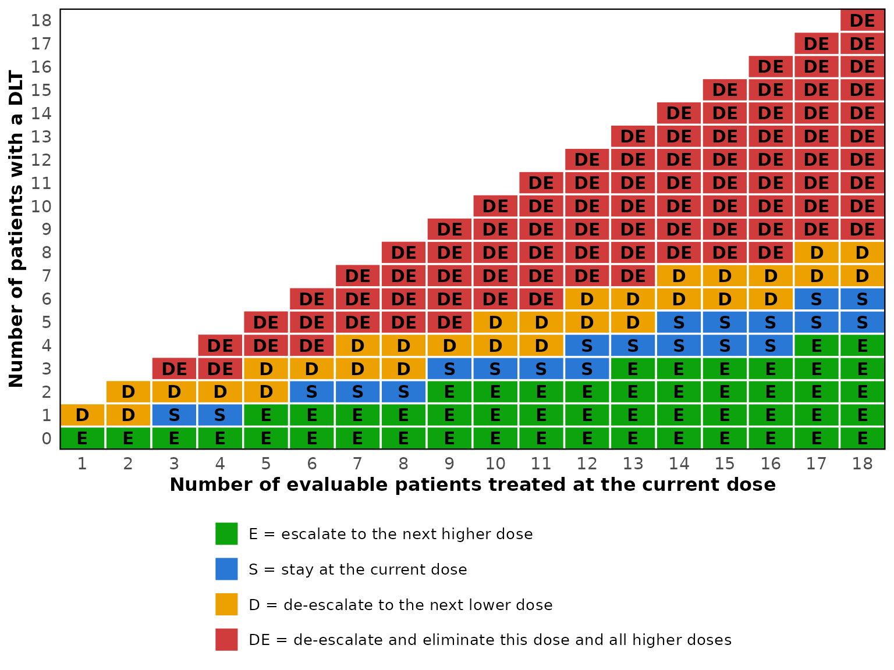
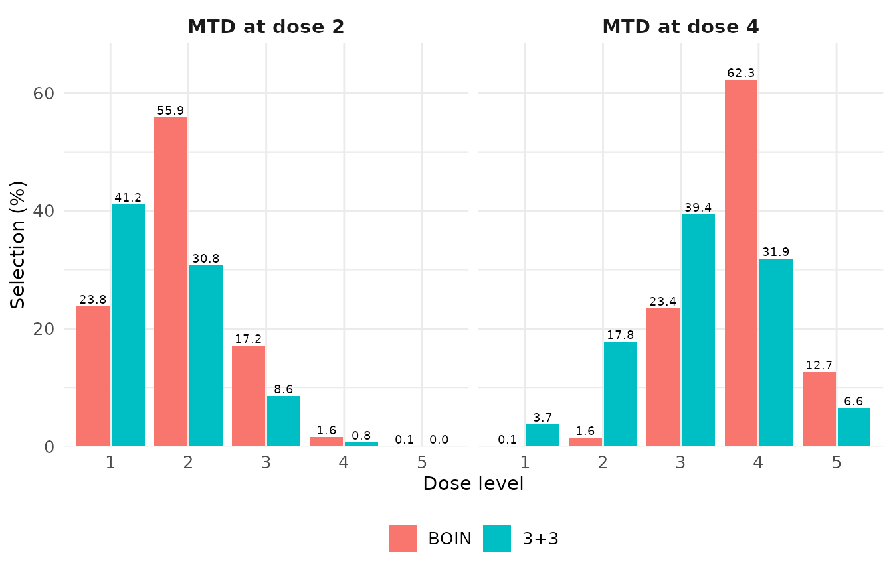
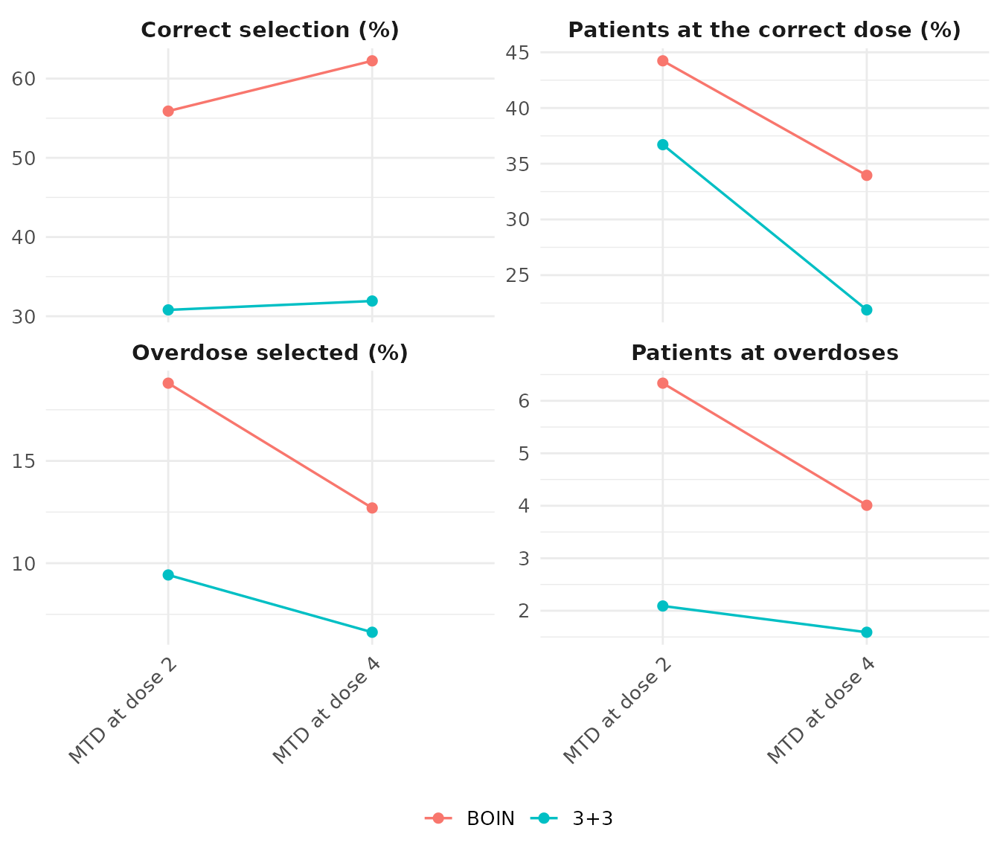

# Getting started with simFastBOIN: BOIN, iBOIN and gBOIN

## What the package does

The Bayesian optimal interval (BOIN) design assigns a cohort of patients
to a dose, counts how many experienced a dose-limiting toxicity, and
compares the observed rate against two boundaries. If the rate is at or
below the lower boundary the next cohort is escalated, if it reaches the
upper boundary the next cohort is de-escalated, and otherwise the dose
is repeated. The rule is as simple to run as a 3+3 design, and Liu and
Yuan report average performance comparable to that of the continual
reassessment method.

This package provides the boundaries, a fast simulation engine for
operating characteristics, and the MTD selection rule applied at the end
of a trial. The traditional 3+3 design is included as a comparator, so
the two can be tabulated side by side. For toxicity that appears late in
the assessment window, the time-to-event version of the design has a
vignette of its own,
[`vignette("simFastBOIN-tite")`](https://gosukehommaex.github.io/simFastBOIN/articles/simFastBOIN-tite.md),
and so do the designs that backfill patients to lower doses while the
escalation waits,
[`vignette("simFastBOIN-backfill")`](https://gosukehommaex.github.io/simFastBOIN/articles/simFastBOIN-backfill.md),
and the designs for trials of two drugs given together, which look for
one MTD combination or for the MTD contour,
[`vignette("simFastBOIN-combination")`](https://gosukehommaex.github.io/simFastBOIN/articles/simFastBOIN-combination.md).
The designs that look for the optimal biological dose, which weighs the
response against the toxicity, are described in
[`vignette("simFastBOIN-boin-et")`](https://gosukehommaex.github.io/simFastBOIN/articles/simFastBOIN-boin-et.md)
(BOIN-ET, its time-to-event and backfill versions, gBOIN-ET and
TITE-gBOIN-ET for graded outcomes and BOIN-ETC for two drugs) and
[`vignette("simFastBOIN-boin12")`](https://gosukehommaex.github.io/simFastBOIN/articles/simFastBOIN-boin12.md)
(BOIN12, TITE-BOIN12, Comb-BOIN12, TITE-Comb-BOIN12 and U-BOIN). Two
extensions of the design itself are described below: iBOIN, which brings
prior information on the DLT rates into the boundaries, and gBOIN, which
decides from toxicity grades. The functions of the section “Tables and
figures” below set the results of these designs side by side, all but
the waterfall design, which selects several combinations in a trial.

## Decision boundaries

[`boin_lambda()`](https://gosukehommaex.github.io/simFastBOIN/reference/boin_lambda.md)
returns the two interval boundaries, which depend only on the target
rate and the two thresholds around it.

``` r

boin_lambda(target = 0.30)
#> $lambda_e
#> [1] 0.2364907
#> 
#> $lambda_d
#> [1] 0.3585195
```

In practice the boundaries are used as whole numbers of toxicities.
[`boin_boundary()`](https://gosukehommaex.github.io/simFastBOIN/reference/boin_boundary.md)
tabulates them, together with the elimination boundary, for every
attainable sample size at a dose.

``` r

bd <- boin_boundary(target = 0.30, max_n = 18, extrasafe = TRUE)
print(bd, cohort_size = 3)
#> BOIN decision boundaries
#>   target DLT rate : 0.3
#>   p_saf / p_tox   : 0.18 / 0.42
#>   lambda_e        : 0.2365
#>   lambda_d        : 0.3585
#>   cutoff_eli      : 0.95
#>   safety cutoff   : 0.9
#> 
#>                                                  
#> Number of patients treated         3 6 9 12 15 18
#> Escalate if # of DLT <=            0 1 2  2  3  4
#> Deescalate if # of DLT >=          2 3 4  5  6  7
#> Eliminate if # of DLT >=           3 4 5  7  8  9
#> Stop at lowest dose if # of DLT >= 2 4 5  6  7  8
```

Reading the first column: with three patients treated, escalate on zero
toxicities, de-escalate on two or more, and stay on exactly one.

The same information can be read as a table indexed by both counts.
Printing it with a cohort size shows only the sample sizes that are
actually reached.

``` r

decisions <- boin_decision_table(target = 0.30, max_n = 18)

print(decisions, cohort_size = 3)
#>     Patients
#> DLTs 3  6  9  12 15 18
#>   0  E  E  E  E  E  E 
#>   1  S  E  E  E  E  E 
#>   2  D  S  E  E  E  E 
#>   3  DE D  S  S  E  E 
#>   4     DE D  S  S  E 
#>   5     DE DE D  S  S 
#>   6     DE DE D  D  S 
#>   7        DE DE D  D 
#>   8        DE DE DE D 
#>   9        DE DE DE DE
#>   10          DE DE DE
#>   11          DE DE DE
#>   12          DE DE DE
#>   13             DE DE
#>   14             DE DE
#>   15             DE DE
#>   16                DE
#>   17                DE
#>   18                DE
#> 
#> E = escalate, S = stay, D = de-escalate, DE = de-escalate and eliminate this dose and above
```

For a protocol the table is usually easier to read as a picture. Every
cell carries its decision letter, so the figure survives grayscale
printing.

``` r

plot(decisions)
```



When `extrasafe = TRUE` there is a second, stricter rule that applies at
the lowest dose only.
[`boin_stopping_table()`](https://gosukehommaex.github.io/simFastBOIN/reference/boin_stopping_table.md)
lays it out the same way.

``` r

boin_stopping_table(bd, cohort_size = 3)
#>                                                               3 6 9 12 15 18
#> Number of evaluable patients treated at the lowest dose level 3 6 9 12 15 18
#> Stop the trial if # of DLT >=                                 2 4 5  6  7  8
```

## Operating characteristics for one scenario

[`sim_boin()`](https://gosukehommaex.github.io/simFastBOIN/reference/sim_boin.md)
simulates the design many times under an assumed dose-toxicity curve and
summarizes the result.

``` r

oc <- sim_boin(
  target = 0.30,
  p_true = c(0.05, 0.15, 0.30, 0.45, 0.60),
  n_cohort = 10,
  cohort_size = 3,
  n_trials = 2000,
  seed = 123
)

oc
#> BOIN operating characteristics
#>   target DLT rate : 0.3
#>   trials          : 2000
#>   cohorts         : 10 of size 3
#>   max sample size : 30
#>   lambda_e / _d   : 0.2365 / 0.3585
#> 
#>                   DL1  DL2  DL3  DL4  DL5 Total / No MTD
#> True DLT rate (%) 5.0 15.0 30.0 45.0 60.0               
#> MTD selected (%)  1.2 25.0 53.1 19.1  1.6            0.0
#> Patients treated  4.1  8.8 10.9  4.5  0.8           29.2
#> Patients with DLT 0.2  1.3  3.3  2.0  0.5            7.4
#> 
#> Doses above a true DLT rate of 0.3: DL4, DL5
#>   Patients treated there              : 18.3%
#>   Trials treating any patient there   : 55.8%
#>   Trials treating over 60% there      : 2.1%
#>   Trials treating over 80% there      : 0%
#>   Trials selecting an MTD there       : 20.6%
```

The third dose is the true MTD here, and it is the dose selected most
often. The components of the result are available individually.

``` r

oc$sel_percent
#>   DL1   DL2   DL3   DL4   DL5 
#>  1.20 24.95 53.15 19.10  1.55
oc$percent_no_mtd
#> [1] 0.05
oc$overdose$pct_patients
#> [1] 18.30761
```

## Comparing scenarios

A design is judged across a range of plausible curves rather than one.
[`sim_boin_multi()`](https://gosukehommaex.github.io/simFastBOIN/reference/sim_boin_multi.md)
runs the same design under several scenarios and collects the results
into one table.

``` r

scenarios <- list(
  "MTD at dose 2" = c(0.15, 0.30, 0.45, 0.60, 0.75),
  "MTD at dose 4" = c(0.02, 0.06, 0.15, 0.30, 0.50),
  "All doses toxic" = c(0.40, 0.55, 0.65, 0.75, 0.85)
)

sim_boin_multi(
  target = 0.30,
  scenarios = scenarios,
  n_cohort = 10,
  cohort_size = 3,
  n_trials = 2000,
  seed = 123
)
#> BOIN operating characteristics across 3 scenarios
#>   target DLT rate : 0.3
#>   trials each     : 2000
#>   max sample size : 30
#> 
#>         Scenario              Item  DL1  DL2  DL3  DL4  DL5 Total / No MTD
#>    MTD at dose 2 True DLT rate (%) 15.0 30.0 45.0 60.0 75.0               
#>                   MTD selected (%) 23.8 55.9 17.2  1.6  0.0            1.5
#>                   Patients treated  9.1 12.2  5.4  0.9  0.0           27.6
#>                  Patients with DLT  1.3  3.7  2.5  0.5  0.0            8.1
#>    MTD at dose 4 True DLT rate (%)  2.0  6.0 15.0 30.0 50.0               
#>                   MTD selected (%)  0.0  1.6 23.4 62.3 12.7            0.0
#>                   Patients treated  3.2  4.2  8.2 10.1  4.0           29.8
#>                  Patients with DLT  0.1  0.3  1.2  3.0  2.1            6.7
#>  All doses toxic True DLT rate (%) 40.0 55.0 65.0 75.0 85.0               
#>                   MTD selected (%) 57.3  2.3  0.0  0.0  0.0           40.4
#>                   Patients treated 13.7  2.9  0.3  0.0  0.0           16.9
#>                  Patients with DLT  5.5  1.6  0.2  0.0  0.0            7.3
```

## Design options

Six options change how the design behaves.

`titration = TRUE` treats one patient per dose until the first toxicity,
which moves through safe doses quickly.

``` r

safe_curve <- c(0.01, 0.02, 0.05, 0.12, 0.30)

plain <- sim_boin(target = 0.30, p_true = safe_curve, n_cohort = 12,
                  cohort_size = 3, n_trials = 1000, seed = 1)
titrated <- sim_boin(target = 0.30, p_true = safe_curve, n_cohort = 12,
                     cohort_size = 3, n_trials = 1000, titration = TRUE, seed = 1)

rbind(plain = plain$n_pts_dose, titrated = titrated$n_pts_dose)
#>            DL1   DL2   DL3   DL4    DL5
#> plain    3.099 3.285 3.888 8.136 14.976
#> titrated 1.063 1.164 1.736 7.516 15.997
```

`titration_doses` ends the titration at a given dose: when no DLT is
seen up to it, full cohorts start at the next dose. With
`titration_doses = 2` and `n_earlystop = 6`, which stops the trial once
six patients are at the current dose and the design would stay, this is
the accelerated BOIN design of Kojima, Wende and Zhao (2024).

``` r

standard <- sim_boin(target = 0.30, p_true = safe_curve, n_cohort = 8,
                     cohort_size = 3, n_trials = 1000, seed = 1)
accelerated <- sim_boin(target = 0.30, p_true = safe_curve, n_cohort = 8,
                        cohort_size = 3, n_trials = 1000, titration = TRUE,
                        titration_doses = 2, n_earlystop = 6, seed = 1)

round(rbind(standard = c(standard$sel_percent,
                         patients = standard$total_n_pts),
            accelerated = c(accelerated$sel_percent,
                            patients = accelerated$total_n_pts)), 1)
#>             DL1 DL2 DL3  DL4  DL5 patients
#> standard    0.0 0.0 1.5 27.3 71.2     24.0
#> accelerated 0.1 0.2 2.5 23.4 73.8     16.4
```

With at most 24 patients, the accelerated design treats 16.4 patients on
average against 24 for the standard design.
`inst/reproduce/reproduce_Kojima2024.R` compares it with Tables 1 and 2
of the article: 83 of the 84 values of the accelerated design lie within
four standard errors of the published ones.

`extrasafe = TRUE` adds a stopping rule at the lowest dose that is
easier to trigger than elimination, and `bound_mtd = TRUE` refuses to
select a dose whose estimated toxicity exceeds the de-escalation
boundary.

``` r

toxic_curve <- c(0.35, 0.45, 0.55, 0.65, 0.75)

c(
  plain = sim_boin(target = 0.30, p_true = toxic_curve, n_cohort = 12,
                   cohort_size = 3, n_trials = 1000, seed = 2)$percent_no_mtd,
  extrasafe = sim_boin(target = 0.30, p_true = toxic_curve, n_cohort = 12,
                       cohort_size = 3, n_trials = 1000, extrasafe = TRUE,
                       seed = 2)$percent_no_mtd
)
#>     plain extrasafe 
#>      24.5      43.3
```

`n_earlystop` stops a trial once the current dose has accrued this many
patients and the design would stay there, which is taken as a sign that
the algorithm has settled. It defaults to 18. Note that the reference
implementation in the BOIN package defaults to 100, which effectively
switches the rule off, so a comparison between the two should set it
explicitly.

For some target rates one DLT out of three patients de-escalates the
dose, where the 3+3 design would stay. `stay_on_1_of_3 = TRUE` aligns
the design with that practice by raising the de-escalation boundary at
three patients, which changes one cell of the table and nothing else.

``` r

c(default = boin_decision_table(0.25, 9)["1", "3"],
  modified = boin_decision_table(0.25, 9, stay_on_1_of_3 = TRUE)["1", "3"])
#>  default modified 
#>      "D"      "S"
```

## Prior information on the DLT rates: iBOIN

The iBOIN design of Zhou, Lee, Wang, Bailey and Yuan (2021) brings into
the boundaries what is known about the doses before the trial, for
example from a trial of the same drug in another population. The prior
information is a skeleton, a prior DLT rate for every dose, and a prior
effective sample size (`prior_ess`), the number of patients that the
prior is worth. The boundaries then depend on the dose: they move
towards the decision that the skeleton favors, by an amount that
decreases as patients are treated at the dose, so that the data override
the prior as they accumulate.
[`iboin_boundary()`](https://gosukehommaex.github.io/simFastBOIN/reference/iboin_boundary.md)
tabulates them; with this skeleton and a prior effective sample size of
3 they are the boundaries of Table 1 of the article.

``` r

skeleton <- c(0.10, 0.19, 0.30, 0.42, 0.54)
ibd <- iboin_boundary(target = 0.30, skeleton = skeleton, prior_ess = 3,
                      max_n = 30)
print(ibd, cohort_size = 3)
#> iBOIN decision boundaries
#>   target DLT rate : 0.3
#>   p_saf / p_tox   : 0.18 / 0.42
#>   cutoff_eli      : 0.95
#>   robust prior    : no
#> 
#> Prior information:
#>     Skeleton Prior ESS Pr(target) Pr(p_saf) Pr(p_tox)
#> DL1     0.10         3      0.326     0.445     0.230
#> DL2     0.19         3      0.332     0.392     0.276
#> DL3     0.30         3      0.335     0.332     0.333
#> DL4     0.42         3      0.333     0.271     0.396
#> DL5     0.54         3      0.326     0.215     0.459
#> 
#> Number of patients treated at the current dose (columns):
#>                                3 6 9 12 15 18 21 24 27 30
#> DL1 escalate if # of DLT <=    1 1 2  3  4  4  5  6  6  7
#> DL1 de-escalate if # of DLT >= 2 3 4  5  7  8  9 10 11 12
#> DL2 escalate if # of DLT <=    0 1 2  3  3  4  5  5  6  7
#> DL2 de-escalate if # of DLT >= 2 3 4  5  6  7  8  9 11 12
#> DL3 escalate if # of DLT <=    0 1 2  2  3  4  4  5  6  7
#> DL3 de-escalate if # of DLT >= 2 3 4  5  6  7  8  9 10 11
#> DL4 escalate if # of DLT <=    0 1 1  2  3  3  4  5  6  6
#> DL4 de-escalate if # of DLT >= 1 2 3  4  6  7  8  9 10 11
#> DL5 escalate if # of DLT <=    0 0 1  2  2  3  4  5  5  6
#> DL5 de-escalate if # of DLT >= 1 2 3  4  5  6  7  8 10 11
#> Eliminate if # of DLT >=       3 4 5  7  8  9 10 11 12 14
```

Where the BOIN design stays on one DLT out of three patients, the iBOIN
design with this prior escalates from dose 1, whose skeleton value lies
well below the target, and de-escalates from dose 5, whose skeleton
value lies well above it. Dose elimination and the stopping rule of
`extrasafe` keep the uniform prior of the BOIN design, so that a
misleading skeleton cannot weaken them. Titration is not available.

Scenarios 3 and 9 of the article show what the prior gains and what it
can cost. In Scenario 3 the skeleton above puts the prior MTD, the dose
whose skeleton value is closest to the target, at the true MTD, dose 3;
in Scenario 9 the skeleton puts it at dose 3, two doses below the true
MTD. The trials have 30 patients in cohorts of three and are not stopped
early, as in the article, and a prior effective sample size of 0 gives
the BOIN design.

``` r

zhou <- list(
  "Scenario 3" = list(p_true = c(0.08, 0.15, 0.31, 0.45, 0.55),
                      skeleton = c(0.10, 0.19, 0.30, 0.42, 0.54), mtd = 3),
  "Scenario 9" = list(p_true = c(0.04, 0.08, 0.10, 0.18, 0.27),
                      skeleton = c(0.04, 0.09, 0.30, 0.40, 0.45), mtd = 5)
)
correct <- sapply(zhou, function(s) {
  run <- function(...) {
    oc <- sim_iboin(target = 0.30, p_true = s$p_true, skeleton = s$skeleton,
                    n_cohort = 10, cohort_size = 3, n_earlystop = 100,
                    n_trials = 2000, seed = 123, ...)
    unname(oc$sel_percent[s$mtd])
  }
  c(BOIN = run(prior_ess = 0), iBOIN = run(prior_ess = 3),
    "iBOIN, robust prior" = run(prior_ess = 3, robust = TRUE),
    "iBOIN, MTD from the data" = run(prior_ess = 3,
                                     select_with_prior = FALSE))
})
round(correct, 1)
#>                          Scenario 3 Scenario 9
#> BOIN                           53.9       69.2
#> iBOIN                          60.2       50.1
#> iBOIN, robust prior            58.2       69.2
#> iBOIN, MTD from the data       54.5       61.0
```

The table gives the percentage of trials selecting the true MTD. With
the right prior, iBOIN selects it in 60.2 percent of the trials against
53.9 for BOIN; with the misleading one, in 50.1 percent against 69.2.
The robust prior of the article (`robust = TRUE`) sets the prior
effective sample size of the doses above the prior MTD to 0 when the
number of the prior MTD is at least half the number of doses, as in both
scenarios here: it selects the true MTD in 69.2 percent of the trials of
Scenario 9 and in 58.2 percent of those of Scenario 3.

At the end of the trial the article gives two estimates of the DLT rates
for the selection of the MTD, with and without the prior information,
and does not say which one its simulations use. They are reproduced with
the prior information, the default of
[`sim_iboin()`](https://gosukehommaex.github.io/simFastBOIN/reference/sim_iboin.md)
and
[`iboin_select_mtd()`](https://gosukehommaex.github.io/simFastBOIN/reference/iboin_select_mtd.md).
Selecting the MTD from the data alone (`select_with_prior = FALSE`)
selects the true MTD in 54.5 percent of the trials of Scenario 3 and in
61 percent of those of Scenario 9: it gives up most of the gain of the
right prior and recovers about half of the loss of the misleading one.

`inst/reproduce/reproduce_Zhou2021.R` compares the package with the
article.
[`iboin_boundary()`](https://gosukehommaex.github.io/simFastBOIN/reference/iboin_boundary.md)
gives 100 of the 100 boundaries of Table 1 exactly, and of the 150
values of the rows BOIN, iBOIN and iBOINR of Table S.1 of its supporting
information, 144 lie within simulation error. The 6 explained values are
the percentages of patients above the MTD in Scenarios 2 and 10, where
the published values agree with the percentage of patients treated at
doses whose true DLT rate exceeds 0.40. The trials agree exactly with an
implementation written in Python and fed with the same random numbers,
and without prior information they are those of
[`sim_boin()`](https://gosukehommaex.github.io/simFastBOIN/reference/sim_boin.md)
for the same seed.

## Toxicity grades: gBOIN

The gBOIN design of Mu, Yuan, Xu, Mandrekar and Yin (2019) decides from
the grade of the toxicity rather than from the DLT alone. Every grade
carries a score, such as the equivalent toxicity score (ETS): 0 for
grades 0 and 1, 0.5 for grade 2, 1 for grade 3 and 1.5 for grade 4. The
scores are divided by their maximum, so that they lie between 0 and 1
and count like fractions of a DLT, and the mean score of the patients at
the current dose takes the place of the observed DLT rate, with the
boundaries of the BOIN design for the target. The target is on the same
scale: a target ETS of 0.47 is a target of 0.47 / 1.5 = 0.313.

The true probabilities of the grades form a matrix with one row per
grade and one column per dose. Scenario 1 of the article has six doses
and 30 patients in cohorts of three, without early stopping.

``` r

p_grade <- rbind(
  "Grade 0-1" = c(0.83, 0.75, 0.62, 0.51, 0.34, 0.19),
  "Grade 2" = c(0.12, 0.15, 0.18, 0.19, 0.16, 0.11),
  "Grade 3" = c(0.04, 0.07, 0.11, 0.14, 0.15, 0.11),
  "Grade 4" = c(0.01, 0.03, 0.09, 0.16, 0.35, 0.59)
)
oc_grade <- sim_gboin(target = 0.47 / 1.5, p_grade = p_grade,
                      score = c(0, 0.5, 1, 1.5), n_cohort = 10,
                      cohort_size = 3, n_earlystop = 100, n_trials = 2000,
                      seed = 123)
oc_grade
#> gBOIN operating characteristics
#>   target score    : 0.3133333
#>   trials          : 2000
#>   cohorts         : 10 of size 3
#>   max sample size : 30
#>   lambda_e / _d   : 0.2471 / 0.3746
#> 
#>                  DL1  DL2  DL3  DL4  DL5  DL6 Total / No MTD
#> True score (%)   7.7 12.7 22.3 31.7 50.3 70.0               
#> MTD selected (%) 0.1  2.8 33.8 52.9 10.2  0.2            0.0
#> Patients treated 3.5  5.4  9.3  8.6  2.8  0.3           30.0
#> Toxicity score   0.3  0.7  2.1  2.8  1.5  0.2            7.5
#> 
#> Doses above a true score of 0.3133333: DL4, DL5, DL6
#>   Patients treated there              : 39.2%
#>   Trials treating any patient there   : 83.9%
#>   Trials treating over 60% there      : 23.8%
#>   Trials treating over 80% there      : 0%
#>   Trials selecting an MTD there       : 63.3%
round(oc_grade$n_grade_dose, 2)
#>            DL1  DL2  DL3  DL4  DL5  DL6
#> Grade 0-1 2.92 4.06 5.77 4.34 0.92 0.06
#> Grade 2   0.43 0.80 1.67 1.66 0.44 0.03
#> Grade 3   0.14 0.36 1.05 1.21 0.45 0.03
#> Grade 4   0.04 0.15 0.84 1.41 1.01 0.19
```

The true mean normalized scores of the doses are 0.077, 0.127, 0.223,
0.317, 0.503, 0.700, so that dose 4 is the MTD; it is selected in 52.9
percent of the trials. The last table gives the average number of
patients of every grade at every dose.

A dose with at least three patients is eliminated, with every higher
dose, when the posterior probability that its mean score exceeds the
target is above `cutoff_eli`, evaluated at the total score
(`elim_rule = "posterior"`, the rule of the article). The
‘UnifiedDoseFinding’ package applies instead the elimination boundary of
the number of DLTs to the total score, which eliminates a dose a little
later; `elim_rule = "count"` gives its rule, for comparisons with it.
With two grades scored 0 and 1 the design is the BOIN design, and for
the same seed the trials are those of
[`sim_boin()`](https://gosukehommaex.github.io/simFastBOIN/reference/sim_boin.md):

``` r

p_dlt <- c(0.05, 0.15, 0.30, 0.45, 0.60)
oc_two <- sim_gboin(target = 0.30, p_grade = rbind(1 - p_dlt, p_dlt),
                    score = c(0, 1), n_cohort = 10, cohort_size = 3,
                    n_trials = 1000, seed = 123)
oc_bin <- sim_boin(target = 0.30, p_true = p_dlt, n_cohort = 10,
                   cohort_size = 3, n_trials = 1000, seed = 123)
identical(oc_two$sel_percent, oc_bin$sel_percent)
#> [1] TRUE
```

The continuous end points of the article are not provided.

`inst/reproduce/reproduce_Mu2019.R` reproduces 14 of the 14 boundaries
of Table 2 of the article and compares the selection percentages and the
numbers of patients of its Table 5 with simulations: 101 of the 120
cells lie within simulation error and 3 hold misprints. The other 16, 7
of them in Scenario 10, do not agree for a reason that was not found; 13
of them also lie outside the allowance when they are compared with the
values of the ‘UnifiedDoseFinding’ package, which the first author of
the article co-wrote. With `elim_rule = "count"`, 130 of the 130 values
of `inst/validation/compare-with-UnifiedDoseFinding.R` agree with the
‘UnifiedDoseFinding’ package within simulation error. The trials agree
exactly with an implementation written in Python and fed with the same
random numbers.

## Working with the trial data

[`boin_simulate()`](https://gosukehommaex.github.io/simFastBOIN/reference/boin_simulate.md)
returns the raw counts, which is useful when a summary other than the
built-in one is needed.

``` r

trials <- boin_simulate(
  target = 0.30,
  p_true = c(0.05, 0.15, 0.30, 0.45, 0.60),
  n_cohort = 10,
  cohort_size = 3,
  n_trials = 1000,
  seed = 123
)

trials
#> Simulated BOIN trials
#>   trials          : 1000
#>   doses           : 5
#>   target DLT rate : 0.3
#>   cohorts         : 10 of size 3
#>   max sample size : 30
#> 
#> Average per trial:
#>                   DL1  DL2   DL3  DL4  DL5
#> Patients treated 4.17 8.90 10.78 4.49 0.77
#> DLTs observed    0.22 1.37  3.21 2.05 0.46
#> 
#> Stopping reason (%):
#> 
#> lowest_dose_eliminated        max_sample_size            n_earlystop 
#>                    0.1                   79.3                   20.6
```

The MTD selection rule can then be applied separately, which makes it
possible to compare selection rules on one set of simulated trials.

``` r

free <- boin_select_mtd(trials$n_pts, trials$n_tox, target = 0.30)
bounded <- boin_select_mtd(trials$n_pts, trials$n_tox, target = 0.30,
                           bound_mtd = TRUE)

table(free$mtd, bounded$mtd, useNA = "ifany")
#>       
#>          1   2   3   4   5 <NA>
#>   1     12   0   0   0   0    0
#>   2      4 242   0   0   0    0
#>   3      0  92 449   0   0    0
#>   4      0   0  60 125   0    0
#>   5      0   0   0   7   8    0
#>   <NA>   0   0   0   0   0    1
```

The estimated dose-toxicity curve behind those decisions is available on
its own.

``` r

round(boin_isotonic(trials$n_pts[1:5, ], trials$n_tox[1:5, ]), 3)
#>        DL1   DL2   DL3   DL4   DL5
#> [1,] 0.016 0.017 0.017 0.334    NA
#> [2,] 0.016 0.224 0.664    NA    NA
#> [3,] 0.016 0.172 0.225 0.500    NA
#> [4,] 0.016 0.172 0.172 0.172 0.445
#> [5,] 0.016 0.058 0.664    NA    NA
```

## Comparing with the 3+3 design

[`oc_3p3()`](https://gosukehommaex.github.io/simFastBOIN/reference/oc_3p3.md)
gives the operating characteristics of the traditional 3+3 design. The
probability of every path the design can take is evaluated in closed
form, so the result carries no Monte Carlo error and takes no seed.

``` r

oc_3p3(p_true = c(0.05, 0.15, 0.25, 0.45, 0.60))
#> 3+3 operating characteristics
#>   MTD rule        : previous (dose below the toxic one)
#>   obtained by     : exact enumeration
#>   start dose      : DL1
#>   max sample size : 30 (six per dose)
#> 
#>                    DL1  DL2  DL3  DL4  DL5 Total / No MTD
#> True DLT rate (%)  5.0 15.0 25.0 45.0 60.0               
#> MTD selected (%)  18.1 31.7 36.4 10.2  0.9            2.7
#> Patients treated   3.4  3.9  3.4  2.0  0.4           13.1
#> Patients with DLT  0.2  0.6  0.8  0.9  0.3            2.8
#> 
#> Doses above a true DLT rate of 0.3333: DL4, DL5
#>   Patients treated there              : 18.6%
#>   Trials treating any patient there   : 47.5%
#>   Trials selecting an MTD there       : 11.1%
```

Two definitions of the MTD are in common use and `mtd_rule` chooses
between them. The default, `"previous"`, names the dose below the one
declared too toxic. The other takes the MTD to be the highest dose at
which at most one of six patients had a DLT, expanding a dose that has
only three patients before assessing it.

``` r

expanded <- oc_3p3(p_true = c(0.05, 0.15, 0.25, 0.45, 0.60),
                   mtd_rule = "expand")

round(expanded$sel_percent, 1)
#> [1] 19.7 34.4 35.3  7.5  0.5
round(expanded$total_n_pts, 2)
#> [1] 15.52
```

The components of the result carry the same names as those of
[`sim_boin()`](https://gosukehommaex.github.io/simFastBOIN/reference/sim_boin.md),
so the same code can tabulate either design.
[`sim_3p3()`](https://gosukehommaex.github.io/simFastBOIN/reference/sim_3p3.md)
simulates the same design and exists to confirm the closed form rather
than to obtain the numbers.

[`decision_table_3p3()`](https://gosukehommaex.github.io/simFastBOIN/reference/decision_table_3p3.md)
shows the rule itself. With `mtd_rule = "expand"` it also lists the
search for the MTD that follows escalation.

``` r

decision_table_3p3(mtd_rule = "expand")
#> 3+3 decision table, MTD rule: expand (the highest dose with at most 1 DLT in 6)
#> 
#> Dose escalation
#>  Patients DLTs Decision                          
#>  3        0    Escalate                          
#>  3        1    Treat 3 more patients at this dose
#>  3        >= 2 Stop escalation                   
#>  6        <= 1 Escalate                          
#>  6        >= 2 Stop escalation                   
#> 
#> Search for the MTD
#>  Patients DLTs Decision                          
#>  3        0    Treat 3 more patients at this dose
#>  6        <= 1 Select this dose as the MTD       
#>  6        >= 2 Move to the next lower dose       
#> 
#> Stop escalation means that this dose and all higher doses are too
#> toxic. The search for the MTD starts at the dose below the one at which
#> escalation stopped, or at the highest dose when it is escalated from.
#> No MTD is selected when the search moves below the starting dose.
```

## Tables and figures

[`oc_scenarios()`](https://gosukehommaex.github.io/simFastBOIN/reference/oc_scenarios.md)
tabulates the true DLT rates of the scenarios with their true MTDs (and,
when response rates are given, the true utilities and OBDs).
[`oc_results()`](https://gosukehommaex.github.io/simFastBOIN/reference/oc_results.md)
collects the results of any of the simulation functions, of their
`_multi` versions and of
[`oc_3p3()`](https://gosukehommaex.github.io/simFastBOIN/reference/oc_3p3.md)
in one long data frame, and
[`oc_compare()`](https://gosukehommaex.github.io/simFastBOIN/reference/oc_compare.md)
judges them against the true doses: how often the true MTD or OBD is
selected, how many patients are treated there, how often an overdose is
selected and how many patients are treated at overdoses. All three have
[`print()`](https://rdrr.io/r/base/print.html) and
[`plot()`](https://rdrr.io/r/graphics/plot.default.html) methods. The
3+3 design is given as a list of
[`oc_3p3()`](https://gosukehommaex.github.io/simFastBOIN/reference/oc_3p3.md)
results named by the scenarios.

``` r

scenarios_two <- scenarios[c("MTD at dose 2", "MTD at dose 4")]
truth <- oc_scenarios(scenarios_two, target = 0.30)
truth
#> True scenarios: 2 scenario(s), 5 doses 
#> True MTD: DLT probability closest to 0.3 
#> 
#> MTD at dose 2
#>             1    2    3    4    5
#> p_true   0.15 0.30 0.45 0.60 0.75
#> true MTD         *               
#> 
#> MTD at dose 4
#>             1    2    3    4    5
#> p_true   0.02 0.06 0.15 0.30 0.50
#> true MTD                   *

boin_two <- sim_boin_multi(target = 0.30, scenarios = scenarios_two,
                           n_cohort = 10, cohort_size = 3, n_trials = 2000,
                           seed = 123)
three_two <- lapply(scenarios_two, function(p) oc_3p3(p_true = p))

results <- oc_results(BOIN = boin_two, "3+3" = three_two)
comparison <- oc_compare(BOIN = boin_two, "3+3" = three_two, truth = truth)
comparison
#> Comparison of 2 design(s) with the true doses
#> Correct: the true MTD for designs selecting an MTD, the true OBD for designs selecting an OBD
#> Overdose: true DLT probability above 0.3 
#> 
#> MTD at dose 2
#>            Correct (%) Pts at correct (%) Overdose sel. (%) Pts at overdose
#> BOIN (MTD)        55.9               44.2              18.8             6.3
#> 3+3 (MTD)         30.8               36.7               9.4             2.1
#>            No selection (%) Patients
#> BOIN (MTD)              1.5     27.6
#> 3+3 (MTD)              18.6      9.6
#> 
#> MTD at dose 4
#>            Correct (%) Pts at correct (%) Overdose sel. (%) Pts at overdose
#> BOIN (MTD)        62.3               34.0              12.7             4.0
#> 3+3 (MTD)         31.9               21.9               6.6             1.6
#>            No selection (%) Patients
#> BOIN (MTD)              0.0     29.8
#> 3+3 (MTD)               0.5     15.4
```

When the MTD is dose 4, BOIN selects it in 62.3 percent of the trials
and the 3+3 design in 31.9 percent. The selection of every dose is drawn
by the [`plot()`](https://rdrr.io/r/graphics/plot.default.html) method
of
[`oc_results()`](https://gosukehommaex.github.io/simFastBOIN/reference/oc_results.md),
and the comparison by that of
[`oc_compare()`](https://gosukehommaex.github.io/simFastBOIN/reference/oc_compare.md).
[`vignette("simFastBOIN-comparison")`](https://gosukehommaex.github.io/simFastBOIN/articles/simFastBOIN-comparison.md)
applies the three functions to the other designs of the package.

``` r

plot(results)
```



``` r

plot(comparison)
```



## Agreement with the BOIN package

The engine draws one uniform variate per patient, in enrollment order,
and applies the decision rules in the order used by
[`BOIN::get.oc()`](https://rdrr.io/pkg/BOIN/man/get.oc.html). With the
same seed and matching arguments the two implementations agree trial by
trial, not merely on average. The package’s test suite checks this
directly whenever the BOIN package is installed, and
`inst/validation/compare-with-BOIN.R` runs the same comparison over 200
configurations covering every combination of the options the two
packages share.

``` r

reference <- BOIN::get.oc(
  target = 0.30, p.true = c(0.05, 0.15, 0.25, 0.45, 0.60),
  ncohort = 20, cohortsize = 3, n.earlystop = 18,
  ntrial = 1000, seed = 6
)

ours <- sim_boin(
  target = 0.30, p_true = c(0.05, 0.15, 0.25, 0.45, 0.60),
  n_cohort = 20, cohort_size = 3, n_earlystop = 18,
  n_trials = 1000, seed = 6
)

all.equal(unname(ours$sel_percent), reference$selpercent)
all.equal(unname(ours$n_pts_dose), reference$npatients)
```

## References

Kojima, M., Wende, W. and Zhao, H. (2024). Tips for Accelerating BOIN
Design. *Therapeutic Innovation & Regulatory Science*, 58, 1129-1137.

Liu S. and Yuan, Y. (2015). Bayesian Optimal Interval Designs for Phase
I Clinical Trials. *Journal of the Royal Statistical Society: Series C*,
64, 507-523.

Mu, R., Yuan, Y., Xu, J., Mandrekar, S. J. and Yin, J. (2019). gBOIN: a
unified model-assisted phase I trial design accounting for toxicity
grades, and binary or continuous end points. *Journal of the Royal
Statistical Society: Series C*, 68, 289-308.

Yan, F., Zhang, L., Zhou, Y., Pan, H., Liu, S. and Yuan, Y. (2020).
BOIN: An R Package for Designing Single-Agent and Drug-Combination
Dose-Finding Trials Using Bayesian Optimal Interval Designs. *Journal of
Statistical Software*, 94(13), 1-32.

Zhou, Y., Lee, J. J., Wang, S., Bailey, S. and Yuan, Y. (2021).
Incorporating historical information to improve phase I clinical trials.
*Pharmaceutical Statistics*, 20, 1017-1034.
