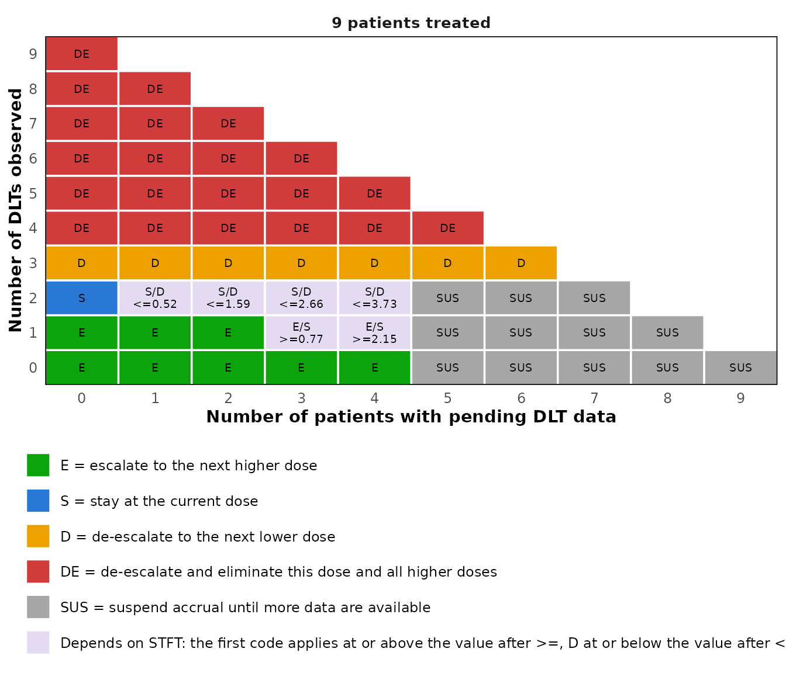

# Late-onset toxicity with the TITE-BOIN design

## Why a time-to-event design

The BOIN design needs every patient’s outcome before the next cohort is
dosed. When toxicity can appear late in a long assessment window, or
patients arrive faster than they can be assessed, that means repeatedly
suspending accrual. The time-to-event BOIN (TITE-BOIN) design treats new
patients while earlier ones are still being followed, and uses the
follow-up time of these pending patients. Two ways of doing so are
available through `method`: the single mean imputation of Yuan et
al. (2018), the default, and the effective sample size of Lin and Yuan
(2020).

## The decision table

The decision table now depends on three counts, the patients treated,
the DLTs observed and the patients pending, and in some states on the
standardized total follow-up time (STFT) of the pending patients, their
total follow-up divided by the length of the window. The table for a
target of 0.2 is Table 1 of Yuan et al. (2018), which the package
reproduces entry by entry.

``` r

tite <- tite_boin_decision_table(target = 0.2, max_n = 15)
print(tite, cohort_size = 3)
#> TITE-BOIN decision table with target 0.2
#> Method: single mean imputation (Yuan et al., 2018); boundaries refer to STFT
#> 
#>  Patients DLTs Pending Escalate Stay    De-escalate
#>  3        0    <= 1    Y                           
#>  3        0    >= 2    Suspend  Suspend Suspend    
#>  3        1    <= 2                     Y          
#>  3        >= 2 <= 1                     Y & Elim   
#>  6        0    <= 3    Y                           
#>  6        0    >= 4    Suspend  Suspend Suspend    
#>  6        1    <= 3             Y                  
#>  6        1    >= 4    Suspend  Suspend Suspend    
#>  6        2    <= 4                     Y          
#>  6        >= 3 <= 3                     Y & Elim   
#>  9        0    <= 4    Y                           
#>  9        0    >= 5    Suspend  Suspend Suspend    
#>  9        1    <= 2    Y                           
#>  9        1    3       >= 0.77  < 0.77             
#>  9        1    4       >= 2.15  < 2.15             
#>  9        1    >= 5    Suspend  Suspend Suspend    
#>  9        2    0                Y                  
#>  9        2    1                > 0.52  <= 0.52    
#>  9        2    2                > 1.59  <= 1.59    
#>  9        2    3                > 2.66  <= 2.66    
#>  9        2    4                > 3.73  <= 3.73    
#>  9        2    >= 5    Suspend  Suspend Suspend    
#>  9        3    <= 6                     Y          
#>  9        >= 4 <= 5                     Y & Elim   
#>  12       0    <= 6    Y                           
#>  12       0    >= 7    Suspend  Suspend Suspend    
#>  12       1    <= 5    Y                           
#>  12       1    6       >= 1.24  < 1.24             
#>  12       1    >= 7    Suspend  Suspend Suspend    
#>  12       2    <= 6             Y                  
#>  12       2    >= 7    Suspend  Suspend Suspend    
#>  12       3, 4 <= 9                     Y          
#>  12       >= 5 <= 7                     Y & Elim   
#>  15       0    <= 7    Y                           
#>  15       0    >= 8    Suspend  Suspend Suspend    
#>  15       1    <= 7    Y                           
#>  15       1    >= 8    Suspend  Suspend Suspend    
#>  15       2    <= 2    Y                           
#>  15       2    3       >= 1.14  < 1.14             
#>  15       2    4       >= 2.31  < 2.31             
#>  15       2    5       >= 3.48  < 3.48             
#>  15       2    6       >= 4.65  < 4.65             
#>  15       2    7       >= 5.82  < 5.82             
#>  15       2    >= 8    Suspend  Suspend Suspend    
#>  15       3    <= 2             Y                  
#>  15       3    3                > 1.16  <= 1.16    
#>  15       3    4                > 2.34  <= 2.34    
#>  15       3    5                > 3.53  <= 3.53    
#>  15       3    6                > 4.72  <= 4.72    
#>  15       3    7                > 5.90  <= 5.90    
#>  15       3    >= 8    Suspend  Suspend Suspend    
#>  15       4, 5 <= 11                    Y          
#>  15       >= 6 <= 9                     Y & Elim   
#> 
#> Patients = treated at the current dose, DLTs = DLTs observed, Pending = assessment not yet completed
#> STFT = total follow-up time of the pending patients divided by the length of the assessment window
#> Accrual is suspended when more than 50% of the patients are pending
#> Y & Elim = de-escalate and eliminate this dose and all higher doses
```

The table is a data frame, so a single state can be looked up. With nine
patients, one DLT and four pending, the dose is escalated once STFT
reaches 2.15. In the trial example of Yuan et al. (2018) the four
pending patients had been followed for 75, 60, 45 and 30 days of a 90
day window, an STFT of 2.33, and the dose was escalated.

``` r

tite[tite$n == 9 & tite$n_tox == 1 & tite$n_pending == 4, ]
#> TITE-BOIN decision table with target 0.2
#> Method: single mean imputation (Yuan et al., 2018); boundaries refer to STFT
#> 
#>  Patients DLTs Pending Escalate Stay   De-escalate
#>  9        1    4       >= 2.15  < 2.15            
#> 
#> Patients = treated at the current dose, DLTs = DLTs observed, Pending = assessment not yet completed
#> STFT = total follow-up time of the pending patients divided by the length of the assessment window
#> Accrual is suspended when more than 50% of the patients are pending
#> Y & Elim = de-escalate and eliminate this dose and all higher doses
```

The same table as a figure, here for nine patients. Each cell is a pair
of pending patients and DLTs; a cell whose decision depends on the
follow-up shows the boundaries, the one after `>=` for escalation and
the one after `<=` for de-escalation.

``` r

plot(tite, n = 9)
```



Under the effective sample size the boundaries refer to ESS, the number
of patients who have completed the assessment plus STFT, and escalation
waits until two patients at the dose have completed it.

``` r

print(tite_boin_decision_table(target = 0.3, max_n = 9, method = "ess"),
      cohort_size = 3)
#> TITE-BOIN decision table with target 0.3
#> Method: effective sample size (Lin and Yuan, 2020); boundaries refer to ESS
#> 
#>  Patients DLTs Pending Escalate           Stay           De-escalate
#>  3        0    <= 1    Y                                            
#>  3        0    >= 2    Suspend            Suspend        Suspend    
#>  3        1    0                          Y                         
#>  3        1    >= 1                       > 2.79         <= 2.79    
#>  3        2    <= 1                                      Y          
#>  3        3    0                                         Y & Elim   
#>  6        0    <= 4    Y                                            
#>  6        0    >= 5    Suspend            Suspend        Suspend    
#>  6        1    <= 1    Y                                            
#>  6        1    2-3     >= 4.23            < 4.23                    
#>  6        1    4       >= 4.23            > 2.79, < 4.23 <= 2.79    
#>  6        1    >= 5    Suspend if >= 4.23 > 2.79, < 4.23 <= 2.79    
#>  6        2    0                          Y                         
#>  6        2    >= 1                       > 5.58         <= 5.58    
#>  6        3    <= 3                                      Y          
#>  6        >= 4 <= 2                                      Y & Elim   
#>  9        0    <= 7    Y                                            
#>  9        0    >= 8    Suspend            Suspend        Suspend    
#>  9        1    <= 4    Y                                            
#>  9        1    5-6     >= 4.23            < 4.23                    
#>  9        1    7       >= 4.23            > 2.79, < 4.23 <= 2.79    
#>  9        1    >= 8    Suspend if >= 4.23 > 2.79, < 4.23 <= 2.79    
#>  9        2    0       Y                                            
#>  9        2    1-3     >= 8.46            < 8.46                    
#>  9        2    >= 4    >= 8.46            > 5.58, < 8.46 <= 5.58    
#>  9        3    0                          Y                         
#>  9        3    >= 1                       > 8.37         <= 8.37    
#>  9        4    <= 5                                      Y          
#>  9        >= 5 <= 4                                      Y & Elim   
#> 
#> Patients = treated at the current dose, DLTs = DLTs observed, Pending = assessment not yet completed
#> STFT = total follow-up time of the pending patients divided by the length of the assessment window
#> ESS = number of patients with a completed assessment plus STFT
#> While patients are pending, escalation requires at least 2 patients with a completed assessment
#> Y & Elim = de-escalate and eliminate this dose and all higher doses
```

## Operating characteristics

[`sim_tite_boin()`](https://gosukehommaex.github.io/simFastBOIN/reference/sim_tite_boin.md)
simulates the design with patients arriving over time. It needs the
length of the assessment window and the accrual rate, in the same unit
of time, and reports the trial duration and the suspensions of accrual
in addition to the summaries of
[`sim_boin()`](https://gosukehommaex.github.io/simFastBOIN/reference/sim_boin.md).

``` r

oc_tite <- sim_tite_boin(
  target = 0.30,
  p_true = c(0.05, 0.15, 0.30, 0.45, 0.60),
  n_cohort = 10,
  cohort_size = 3,
  window = 3,
  accrual_rate = 2,
  n_trials = 2000,
  seed = 123
)

oc_tite
#> TITE-BOIN operating characteristics
#>   method          : single mean imputation (Yuan et al., 2018)
#>   target DLT rate : 0.3
#>   trials          : 2000
#>   cohorts         : 10 of size 3
#>   max sample size : 30
#>   lambda_e / _d   : 0.2365 / 0.3585
#>   window          : 3
#>   accrual         : 2 patients per unit of time (exponential)
#> 
#>                   DL1  DL2  DL3  DL4  DL5 Total / No MTD
#> True DLT rate (%) 5.0 15.0 30.0 45.0 60.0               
#> MTD selected (%)  1.4 28.2 53.3 16.2  0.9            0.0
#> Patients treated  5.6 10.3  9.5  3.4  0.5           29.3
#> Patients with DLT 0.3  1.6  2.9  1.5  0.3            6.6
#> 
#> Doses above a true DLT rate of 0.3: DL4, DL5
#>   Patients treated there              : 13.4%
#>   Trials treating any patient there   : 43.1%
#>   Trials treating over 60% there      : 2.8%
#>   Trials treating over 80% there      : 0%
#>   Trials selecting an MTD there       : 17.1%
#> 
#> Trial duration and suspension of accrual
#>   Average trial duration              : 23.6
#>   Trials with accrual suspended       : 100%
#>   Average number of suspensions       : 4
#>   Average time suspended              : 6.6
```

Faster accrual shortens the trial, at the price of more frequent
suspensions.

``` r

by_rate <- sapply(c(0.5, 1, 2, 4), function(rate) {
  oc <- sim_tite_boin(target = 0.30, p_true = c(0.05, 0.15, 0.30, 0.45, 0.60),
                      n_cohort = 10, cohort_size = 3, window = 3,
                      accrual_rate = rate, n_trials = 1000, seed = 1)
  c(accrual_rate = rate, selected_dose_3 = oc$sel_percent[["DL3"]],
    duration = oc$duration_mean, suspensions = oc$avg_n_suspensions)
})
round(t(by_rate), 2)
#>      accrual_rate selected_dose_3 duration suspensions
#> [1,]          0.5            52.2    61.02        1.35
#> [2,]          1.0            56.2    34.88        2.72
#> [3,]          2.0            53.8    23.62        4.01
#> [4,]          4.0            53.1    19.23        5.01
```

## Agreement with the BOIN design

When no patient is ever pending at a decision, the time-to-event design
is the BOIN design, and the simulation engine reproduces
[`sim_boin()`](https://gosukehommaex.github.io/simFastBOIN/reference/sim_boin.md)
exactly. With arrivals one unit of time apart and a window of half a
unit, every patient has completed the assessment before the next one
arrives.

``` r

no_pending <- sim_tite_boin(target = 0.30,
                            p_true = c(0.05, 0.15, 0.30, 0.45, 0.60),
                            n_cohort = 10, cohort_size = 3, window = 0.5,
                            accrual_rate = 1, accrual = "fixed",
                            n_trials = 1000, seed = 7)
plain_boin <- sim_boin(target = 0.30, p_true = c(0.05, 0.15, 0.30, 0.45, 0.60),
                       n_cohort = 10, cohort_size = 3, n_trials = 1000,
                       seed = 7)

identical(no_pending$sel_percent, plain_boin$sel_percent)
#> [1] TRUE
identical(no_pending$n_pts_dose, plain_boin$n_pts_dose)
#> [1] TRUE
```

## References

Liu S. and Yuan, Y. (2015). Bayesian Optimal Interval Designs for Phase
I Clinical Trials. *Journal of the Royal Statistical Society: Series C*,
64, 507-523.

Yuan, Y., Lin, R., Li, D., Nie, L. and Warren, K. E. (2018).
Time-to-Event Bayesian Optimal Interval Design to Accelerate Phase I
Trials. *Clinical Cancer Research*, 24(20), 4921-4930.

Lin, R. and Yuan, Y. (2020). Time-to-Event Model-Assisted Designs for
Dose-Finding Trials with Delayed Toxicity. *Biostatistics*, 21(4),
807-824.
