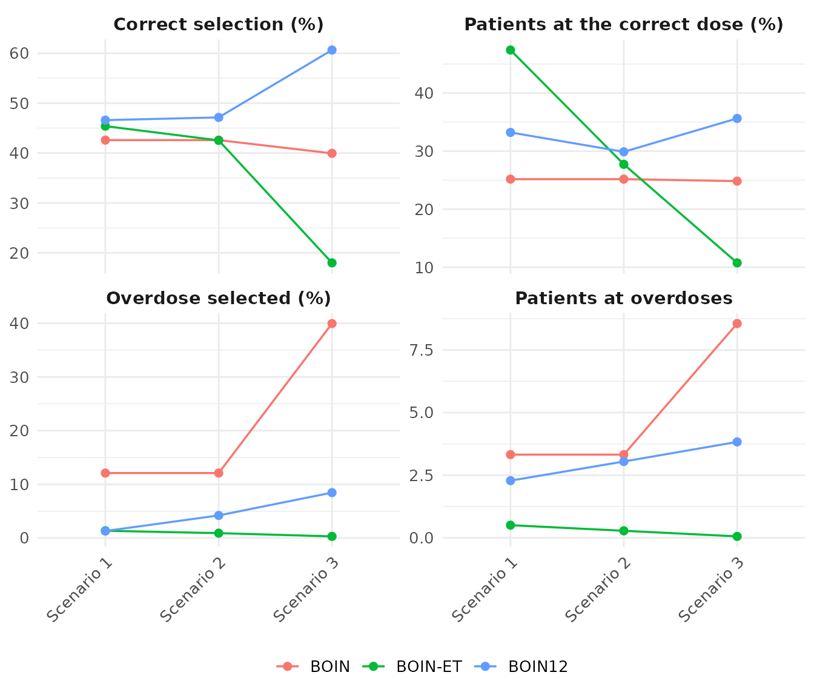

# Utility-based dose finding: BOIN12 and its extensions

## A utility of the response and the toxicity

The BOIN12 design of Lin, Zhou, Yan, Li and Yuan (2020) looks for the
optimal biological dose (OBD) by scoring the four outcomes a patient can
have. A response without a dose-limiting toxicity (DLT) scores 100 and a
DLT without a response 0; a patient with neither scores `psi00` and a
patient with both `psi11`, 40 and 60 by default. The utility of a dose
is the expected score of its patients. After each cohort, the boundaries
of the BOIN design rule out an escalation from a dose that looks too
toxic, and the next cohort goes to the most desirable dose among the
current dose and its neighbors, the desirability being the posterior
probability that the utility of the dose exceeds a benchmark. At the end
of the trial the OBD is the admissible dose, up to the estimated MTD,
with the highest estimated utility.

The package provides four designs of this family:

- **BOIN12** (Lin et al., 2020):
  [`sim_boin12()`](https://gosukehommaex.github.io/simFastBOIN/dev/reference/sim_boin12.md)
  and
  [`sim_boin12_multi()`](https://gosukehommaex.github.io/simFastBOIN/dev/reference/sim_boin12_multi.md);
- **TITE-BOIN12** (Zhou et al., 2022), which treats new patients while
  the DLT or the response of earlier ones is still pending:
  [`sim_tite_boin12()`](https://gosukehommaex.github.io/simFastBOIN/dev/reference/sim_tite_boin12.md)
  and
  [`sim_tite_boin12_multi()`](https://gosukehommaex.github.io/simFastBOIN/dev/reference/sim_tite_boin12_multi.md);
- **Comb-BOIN12** (Lu et al., 2025), for two drugs given together:
  [`sim_comb_boin12()`](https://gosukehommaex.github.io/simFastBOIN/dev/reference/sim_comb_boin12.md)
  and
  [`sim_comb_boin12_multi()`](https://gosukehommaex.github.io/simFastBOIN/dev/reference/sim_comb_boin12_multi.md);
- **TITE-Comb-BOIN12** (Lu et al., 2025), its time-to-event version:
  [`sim_tite_comb_boin12()`](https://gosukehommaex.github.io/simFastBOIN/dev/reference/sim_tite_comb_boin12.md)
  and
  [`sim_tite_comb_boin12_multi()`](https://gosukehommaex.github.io/simFastBOIN/dev/reference/sim_tite_comb_boin12_multi.md).

The U-BOIN design of Zhou, Lee and Yuan (2019), which also scores the
four outcomes of a patient by a utility but runs the BOIN design until a
dose has enough patients, is described in its own section below:
[`sim_uboin()`](https://gosukehommaex.github.io/simFastBOIN/dev/reference/sim_uboin.md)
and
[`sim_uboin_multi()`](https://gosukehommaex.github.io/simFastBOIN/dev/reference/sim_uboin_multi.md).

The trials and the selection of the OBD run in C++. In these functions
`target` is the highest acceptable DLT rate and `target_resp` the lowest
acceptable response rate. The `target_resp` of the BOIN-ET functions,
[`vignette("simFastBOIN-boin-et")`](https://gosukehommaex.github.io/simFastBOIN/dev/articles/simFastBOIN-boin-et.md),
is a different quantity, the response rate that BOIN-ET aims at.

## The desirability score table

[`boin12_decision_table()`](https://gosukehommaex.github.io/simFastBOIN/dev/reference/boin12_decision_table.md)
tabulates, for every number of patients, DLTs and responses at a dose,
whether the dose is admissible and the rank of its desirability among
the outcomes of the table, the score of Table 3 of Lin et al. (2020).

``` r

tab <- boin12_decision_table(target = 0.35, target_resp = 0.25)
tab_3 <- as.data.frame(tab)[tab$n == 3, ]
tab_3[, c("n", "n_tox", "n_resp", "admissible", "score")]
#>    n n_tox n_resp admissible score
#> 2  3     0      0       TRUE    35
#> 3  3     0      1       TRUE    55
#> 4  3     0      2       TRUE    76
#> 5  3     0      3       TRUE    91
#> 6  3     1      0       TRUE    24
#> 7  3     1      1       TRUE    44
#> 8  3     1      2       TRUE    63
#> 9  3     1      3       TRUE    80
#> 10 3     2      0       TRUE    13
#> 11 3     2      1       TRUE    31
#> 12 3     2      2       TRUE    48
#> 13 3     2      3       TRUE    69
#> 14 3     3      0      FALSE    NA
#> 15 3     3      1      FALSE    NA
#> 16 3     3      2      FALSE    NA
#> 17 3     3      3      FALSE    NA
```

With the default numbers of patients, 0, 3, 6 and 9, the table has 166
rows, the cells of Table 3 of Lin et al. (2020); the lines above are
those for three patients. A higher score means a more desirable dose,
and only the order of the scores of the doses compared matters for the
next cohort. With three DLTs among three patients the dose is
inadmissible whatever the responses: under a uniform prior, the
posterior probability that its DLT rate exceeds 0.35 is then 0.985,
above the cutoff 0.95.

## Operating characteristics for one scenario

Scenario 1 of Lin et al. (2020) has five doses, an upper DLT limit of
0.35, a lower response limit of 0.25 and twelve cohorts of three
patients.
[`oc_scenarios()`](https://gosukehommaex.github.io/simFastBOIN/dev/reference/oc_scenarios.md)
gives the true utility of every dose and the true MTD and OBD.

``` r

p_true <- c(0.05, 0.12, 0.27, 0.35, 0.50)
p_resp <- c(0.20, 0.35, 0.36, 0.37, 0.38)

truth_1 <- oc_scenarios(list("Scenario 1" = list(p_true = p_true,
                                                 p_resp = p_resp)),
                        target = 0.35, target_resp = 0.25)
truth_1
#> True scenarios: 1 scenario(s), 5 doses 
#> True MTD: DLT probability closest to 0.35 
#> True OBD: highest utility among the doses with DLT probability <= 0.35 and response probability >= 0.25 
#> Utilities: 100 (response, no DLT), 40 (neither), 60 (both), 0 (DLT, no response)
#> 
#> Scenario 1
#>             1    2    3    4    5
#> p_true   0.05 0.12 0.27 0.35 0.50
#> p_resp   0.20 0.35 0.36 0.37 0.38
#> utility  50.0 56.2 50.8 48.2 42.8
#> true MTD                   *     
#> true OBD         *
```

The response rate hardly increases beyond dose 2 while the DLT rate
does, so the OBD, dose 2, is well below the MTD, dose 4.

``` r

oc <- sim_boin12(target = 0.35, target_resp = 0.25, p_true = p_true,
                 p_resp = p_resp, n_cohort = 12, cohort_size = 3,
                 n_trials = 2000, seed = 123)
oc
#> BOIN12 operating characteristics
#>   DLT limit            : 0.35
#>   response limit       : 0.25
#>   trials               : 2000
#>   cohorts              : 12 of size 3
#>   max sample size      : 36
#>   lambda_e / lambda_d  : 0.2763 / 0.4189
#>   utility scores       : 100, 40, 60, 0; benchmark 70.5
#>   ties / no candidate  : higher / nearest
#>   exploration from     : any
#>   OBD selection        : utility by posterior_mean
#> 
#>                         DL1  DL2  DL3  DL4  DL5 Total / No OBD
#> True DLT rate (%)       5.0 12.0 27.0 35.0 50.0               
#> True response rate (%) 20.0 35.0 36.0 37.0 38.0               
#> OBD selected (%)       21.4 46.6 21.4  9.2  1.3            0.0
#> Patients treated        7.7 12.0  8.5  5.6  2.3           36.0
#> Patients with DLT       0.4  1.5  2.2  1.9  1.2            7.2
#> Patients with response  1.6  4.1  3.1  2.1  0.9           11.7
#> 
#> Trials stopped early: 0%
```

Dose 2 is selected most often, in 46.6 percent of the trials, and 0
percent of the trials select no OBD.

## The rules of the simulations of the article

The defaults follow the BOIN12 software. Three arguments select the
rules under which Lin et al. (2020) simulated the design, where they
differ: `tie_break = "random"` breaks ties of desirability at random
instead of choosing the higher dose, `no_candidate = "stop"` ends the
trial without an OBD when no dose allowed for the next cohort is
admissible instead of going to the nearest admissible dose, and
`explore_from = "admissible"` applies the rule that escalates after 9
patients when the next dose is untried only at an admissible dose. The
article states the first; the other two are not written in it and were
inferred from the published results, which they reproduce (see the last
section).

``` r

oc_article <- sim_boin12(target = 0.35, target_resp = 0.25, p_true = p_true,
                         p_resp = p_resp, n_cohort = 12, cohort_size = 3,
                         n_trials = 2000, tie_break = "random",
                         no_candidate = "stop", explore_from = "admissible",
                         seed = 123)
selection <- rbind(default = c(oc$sel_percent, oc$percent_no_obd),
                   article = c(oc_article$sel_percent,
                               oc_article$percent_no_obd))
colnames(selection) <- c(paste0("DL", 1:5), "None")
round(selection, 1)
#>          DL1  DL2  DL3 DL4 DL5 None
#> default 21.4 46.6 21.4 9.2 1.3  0.0
#> article 19.4 47.5 21.3 9.6 1.8  0.3
```

## TITE-BOIN12

When the DLT and the response take long to assess, TITE-BOIN12 (Zhou et
al., 2022) treats new patients while earlier ones are still followed. A
pending outcome is replaced by its expectation given the time followed,
as in Equation (11) of the article (`pending_estimate = "conditional"`,
the default); `pending_estimate = "marginal"` replaces it by the
estimated rate itself, which reproduces the desirabilities of Table S.3
of their Supplement. While fewer than half of the patients at the
current dose have finished both assessments, the next decision waits
(`min_completed_share = 0.5`). The simulations of the article have
windows of 45 days for the DLT and 60 days for the response and three
patients a month; the unit of time is the day.

``` r

tite <- sim_tite_boin12(target = 0.35, target_resp = 0.25, p_true = p_true,
                        p_resp = p_resp, n_cohort = 12, cohort_size = 3,
                        window = 45, resp_window = 60, accrual_rate = 3 / 30,
                        n_trials = 2000, seed = 123)
tite
#> TITE-BOIN12 operating characteristics
#>   DLT limit            : 0.35
#>   response limit       : 0.25
#>   trials               : 2000
#>   cohorts              : 12 of size 3
#>   max sample size      : 36
#>   lambda_e / lambda_d  : 0.2763 / 0.4189
#>   utility scores       : 100, 40, 60, 0; benchmark 70.5
#>   ties / no candidate  : higher / nearest
#>   exploration from     : any
#>   OBD selection        : utility by posterior_mean
#> 
#>                         DL1  DL2  DL3  DL4  DL5 Total / No OBD
#> True DLT rate (%)       5.0 12.0 27.0 35.0 50.0               
#> True response rate (%) 20.0 35.0 36.0 37.0 38.0               
#> OBD selected (%)       18.1 47.2 21.3 11.1  2.1            0.1
#> Patients treated        7.4 12.1  8.4  5.5  2.5           36.0
#> Patients with DLT       0.4  1.4  2.2  1.9  1.2            7.2
#> Patients with response  1.5  4.3  3.0  2.0  0.9           11.7
#> 
#> Trials stopped early: 0.1%
#> Average trial duration: 563
```

When every decision waits for all the outcomes and the patients arrive
at fixed intervals, the trials are those of BOIN12 with the same seed,
and only the time differs.

``` r

wait <- sim_tite_boin12(target = 0.35, target_resp = 0.25, p_true = p_true,
                        p_resp = p_resp, n_cohort = 12, cohort_size = 3,
                        window = 45, resp_window = 60, accrual_rate = 3 / 30,
                        accrual = "fixed", min_completed_share = 1,
                        n_trials = 2000, seed = 123)
all.equal(wait$sel_percent, oc$sel_percent)
#> [1] TRUE
round(c(TITE = tite$duration, wait = wait$duration) / 30, 1)
#> TITE wait 
#> 18.8 30.6
```

The trials last 18.8 months on average with TITE-BOIN12 and 30.6 months
when every decision waits.

## Comb-BOIN12 and TITE-Comb-BOIN12

Comb-BOIN12 (Lu et al., 2025) applies the utility, the desirability and
the admissibility of BOIN12 to a matrix of combinations of two drugs,
with the levels of drug A in the rows and those of drug B in the
columns. The next cohort goes to a combination chosen by the
desirability among the current one and its neighbors along both drugs,
as BOIN12 does along the doses. At the end the response rates are
estimated by a quadratic logistic model, and the admissible combination
with the highest utility up to the MTD combination is selected. The
utility of the article, `pE - wT * pT`, is that of BOIN12 with
`psi00 = 100 * wT / (1 + wT)` and `psi11 = 100 / (1 + wT)`, and the
weight `w_u` of its benchmark is `benchmark_weight`. Scenario 16 of the
article has two levels of drug A and three of drug B.

``` r

p_true_ab <- matrix(c(0.05, 0.10, 0.15, 0.15, 0.20, 0.45), nrow = 2)
p_resp_ab <- matrix(c(0.10, 0.20, 0.30, 0.40, 0.50, 0.60), nrow = 2)

comb_design <- list(target = 0.33, target_resp = 0.2, p_true = p_true_ab,
                    p_resp = p_resp_ab, n_cohort = 14, cohort_size = 3,
                    psi00 = 100 * 0.11 / 1.11, psi11 = 100 / 1.11,
                    benchmark_weight = 0.6, extrasafe = TRUE, offset = 0.10,
                    n_trials = 1000, seed = 123)
oc_comb <- do.call(sim_comb_boin12, comb_design)
oc_comb
#> Comb-BOIN12 operating characteristics
#>   DLT limit            : 0.33
#>   response limit       : 0.2
#>   dose levels          : 2 of drug A, 3 of drug B
#>   trials               : 1000
#>   cohorts              : 14 of size 3
#>   max sample size      : 42
#>   lambda_e / lambda_d  : 0.2604 / 0.3947
#>   utility scores       : 100, 9.9099, 90.0901, 0; benchmark 54.79
#>   ties / no candidate  : higher / nearest
#>   OBD selection        : logistic response, rectangle bound
#> 
#>                    Item Drug A   B1   B2   B3
#>       True DLT rate (%)     A1  5.0 15.0 20.0
#>                             A2 10.0 15.0 45.0
#>  True response rate (%)     A1 10.0 30.0 50.0
#>                             A2 20.0 40.0 60.0
#>        OBD selected (%)     A1  5.3 13.1 36.6
#>                             A2  3.0 25.2 15.8
#>        Patients treated     A1  4.0  5.7 11.3
#>                             A2  3.4  9.1  8.2
#>       Patients with DLT     A1  0.2  0.9  2.3
#>                             A2  0.3  1.4  3.7
#>  Patients with response     A1  0.4  1.7  5.6
#>                             A2  0.7  3.7  4.9
#> 
#> No OBD selected                      : 1%
#> Trials stopped early                 : 1%
#> Average number of patients           : 41.6
#> 
#> True OBD (highest true utility)      : A1B3
#>   Selected as the OBD                : 36.6%
#>   Patients treated there             : 27.2%
#> Combinations above the DLT limit     : 1 of 6
#>   Selected as the OBD                : 15.8%
#>   Patients treated there             : 19.6%
```

The true OBD combination is A1B3, and it is selected in 36.6 percent of
the trials.

The article states that the OBD combination is chosen among the
combinations up to the levels of both drugs of the MTD combination
(`obd_bound = "rectangle"`, the default). The published selection
percentages agree better with candidates bounded, at every level of drug
B, by the MTD along drug A (`obd_bound = "contour"`), a rule inferred
from the published results. The same trials give

``` r

oc_contour <- do.call(sim_comb_boin12,
                      c(comb_design, list(obd_bound = "contour")))
labels <- paste0("A", rep(1:2, 3), "B", rep(1:3, each = 2))
bounds <- rbind(rectangle = as.vector(oc_comb$sel_percent),
                contour = as.vector(oc_contour$sel_percent))
colnames(bounds) <- labels
round(bounds, 1)
#>           A1B1 A2B1 A1B2 A2B2 A1B3 A2B3
#> rectangle  5.3  3.0 13.1 25.2 36.6 15.8
#> contour    1.0  2.5  4.0 23.0 48.3 20.2
```

TITE-Comb-BOIN12 applies the rules of Comb-BOIN12 at the decision times
of TITE-BOIN12. By default the pending outcomes count in the DLT rate of
the decision, in the admissibility and in the utility, as in
TITE-BOIN12; Sections 2.2 and 3.1 of Lu et al. (2025) state that they
count in the utility only, the decision and the admissibility using the
observed outcomes (`pending_use = "utility"`). The article does not
describe the accrual or the waiting rule, for which the package uses
those of TITE-BOIN12. One of the settings of Figure 2 of the article has
windows of one month for the DLT and two months for the response and two
patients a month, here with uniform times to the events, as Section 2.2
of the article assumes:

``` r

tite_comb_design <- c(comb_design[names(comb_design) != "n_trials"],
                      list(window = 1, resp_window = 2, accrual_rate = 2,
                           event_time = "uniform", n_trials = 500))
oc_tc <- do.call(sim_tite_comb_boin12, tite_comb_design)
oc_tc_utility <- do.call(sim_tite_comb_boin12,
                         c(tite_comb_design, list(pending_use = "utility")))
pending <- rbind(all = c(as.vector(oc_tc$sel_percent), oc_tc$duration),
                 utility = c(as.vector(oc_tc_utility$sel_percent),
                             oc_tc_utility$duration))
colnames(pending) <- c(labels, "Months")
round(pending, 1)
#>         A1B1 A2B1 A1B2 A2B2 A1B3 A2B3 Months
#> all      3.2  2.6 12.0 26.2 38.0 17.8   26.2
#> utility  2.8  3.0 16.2 27.2 37.2 12.8   26.0
```

## U-BOIN

U-BOIN (Zhou, Lee and Yuan, 2019) scores the four outcomes of a patient
as BOIN12 does, with the utilities `utility` of (no response, DLT), (no
response, no DLT), (response, DLT) and (response, no DLT), by default 0,
30, 50 and 100, example 1 of the article. Its posterior mean utility
weights them by the posterior means of the probabilities of the four
outcomes under the Dirichlet(1/4, 1/4, 1/4, 1/4) prior of the article.
The trial has two stages. Stage I runs as the BOIN design with the
target `tox_upper - 0.05`, and a dose with too many DLTs is eliminated
with every higher dose. Once a dose has `n_stage1` patients, 12 by
default, stage II begins: the next cohort escalates above the highest
dose tried while the DLT rate observed there is at most the escalation
boundary, and otherwise goes to the admissible dose with the largest
posterior mean utility. A dose is admissible when it has been tried, is
not eliminated, and is neither toxic, when the posterior probability
that its DLT rate exceeds `tox_upper` is above `cutoff_eli` (0.95), nor
futile, when the posterior probability that its response rate is below
`resp_lower` is above `cutoff_eli_resp` (0.90). At the end of the trial
the OBD is the admissible dose with the largest posterior mean utility.
`tox_upper` and `resp_lower` play the parts of `target` and
`target_resp` of BOIN12.

[`uboin_utility_table()`](https://gosukehommaex.github.io/simFastBOIN/dev/reference/uboin_utility_table.md)
gives, for a number of patients, the posterior mean utility and the
admissibility of a dose for every outcome of its patients, the decision
tables of the supporting information of the article.

``` r

ut <- uboin_utility_table(3, tox_upper = 0.30, resp_lower = 0.20)
ut
#>    n_resp n_tox n_resp_no_tox utility toxic futile admissible
#> 1       0     0             0   33.75 FALSE  FALSE       TRUE
#> 2       0     1             0   26.25 FALSE  FALSE       TRUE
#> 3       0     2             0   18.75 FALSE  FALSE       TRUE
#> 4       0     3             0   11.25  TRUE  FALSE      FALSE
#> 5       1     0             1   51.25 FALSE  FALSE       TRUE
#> 6       1     1             0   38.75 FALSE  FALSE       TRUE
#> 7       1     1             1   43.75 FALSE  FALSE       TRUE
#> 8       1     2             0   31.25 FALSE  FALSE       TRUE
#> 9       1     2             1   36.25 FALSE  FALSE       TRUE
#> 10      1     3             0   23.75  TRUE  FALSE      FALSE
#> 11      2     0             2   68.75 FALSE  FALSE       TRUE
#> 12      2     1             1   56.25 FALSE  FALSE       TRUE
#> 13      2     1             2   61.25 FALSE  FALSE       TRUE
#> 14      2     2             0   43.75 FALSE  FALSE       TRUE
#> 15      2     2             1   48.75 FALSE  FALSE       TRUE
#> 16      2     3             0   36.25  TRUE  FALSE      FALSE
#> 17      3     0             3   86.25 FALSE  FALSE       TRUE
#> 18      3     1             2   73.75 FALSE  FALSE       TRUE
#> 19      3     2             1   61.25 FALSE  FALSE       TRUE
#> 20      3     3             0   48.75  TRUE  FALSE      FALSE
```

For three patients the table has 20 rows. The article does not give the
priors of its toxicity and futility rules. Beta(1, 1) priors, the
defaults (`prior_tox` and `prior_resp`), reproduce its simulations. Its
Tables S4 to S6 mark a dose without any response inadmissible, which
`prior_resp = c(0.05, 0.05)` reproduces and the default does not; for
three patients and the utilities of those tables, the two priors differ
on these outcomes:

``` r

s4 <- uboin_utility_table(3, tox_upper = 0.30, resp_lower = 0.20,
                          utility = c(0, 15, 25, 100),
                          prior_resp = c(0.05, 0.05))
s4_default <- uboin_utility_table(3, tox_upper = 0.30, resp_lower = 0.20,
                                  utility = c(0, 15, 25, 100))
s4[s4$admissible != s4_default$admissible, ]
#>   n_resp n_tox n_resp_no_tox utility toxic futile admissible
#> 1      0     0             0   20.00 FALSE   TRUE      FALSE
#> 2      0     1             0   16.25 FALSE   TRUE      FALSE
#> 3      0     2             0   12.50 FALSE   TRUE      FALSE
```

Scenario 1 of Simulation A of the article has five doses, 54 patients in
cohorts of three, and the DLT and the response of a patient joined by
the Gumbel model with the association parameter 0.2 (`resp_assoc`).

``` r

oc_u <- sim_uboin(tox_upper = 0.30, resp_lower = 0.20,
                  p_true = c(0.02, 0.15, 0.30, 0.45, 0.60),
                  p_resp = c(0.20, 0.65, 0.65, 0.65, 0.65),
                  n_cohort = 18, cohort_size = 3, resp_assoc = 0.2,
                  n_trials = 2000, seed = 123)
oc_u
#> U-BOIN operating characteristics
#>   DLT upper limit      : 0.3
#>   response lower limit : 0.2
#>   stage I target       : 0.25
#>   trials               : 2000
#>   cohorts              : 18 of size 3
#>   max sample size      : 54
#>   stage II from / stop : 12 / 54 patients at a dose
#>   lambda_e / lambda_d  : 0.1968 / 0.2984
#>   utilities            : 0, 30, 50, 100
#>   cutoffs (DLT / resp) : 0.95 / 0.9
#> 
#>                         DL1  DL2  DL3  DL4  DL5 Total / No OBD
#> True DLT rate (%)       2.0 15.0 30.0 45.0 60.0               
#> True response rate (%) 20.0 65.0 65.0 65.0 65.0               
#> True utility           43.3 69.0 62.5 56.0 49.6               
#> OBD selected (%)        1.8 75.0 20.7  2.1  0.2            0.0
#> Patients treated        6.2 30.4 13.4  3.4  0.5           54.0
#> Patients with DLT       0.1  4.6  4.1  1.5  0.3           10.6
#> Patients with response  1.2 19.9  8.7  2.2  0.3           32.3
#> 
#> Trials reaching stage II: 100%
#> Reason for ending (%):
#>        max_sample_size                 n_stop lowest_dose_eliminated 
#>                    100                      0                      0 
#>     no_admissible_dose 
#>                      0
```

The true utility is highest at dose 2, which is selected in 75 percent
of the trials, and 100 percent of the trials reach stage II. The article
does not say either whether stage II can assign a dose that has not been
tried; it cannot here, which the simulations of the article support. A
dose that becomes toxic in stage II does not exclude the doses above it.
Only the pick-the-winner allocation of the article is provided, not its
adaptive and equal randomization or its version for efficacy observed
late. The results enter
[`oc_results()`](https://gosukehommaex.github.io/simFastBOIN/dev/reference/oc_results.md)
and
[`oc_compare()`](https://gosukehommaex.github.io/simFastBOIN/dev/reference/oc_compare.md)
under the name U-BOIN.

## Comparing designs

[`oc_scenarios()`](https://gosukehommaex.github.io/simFastBOIN/dev/reference/oc_scenarios.md),
[`oc_results()`](https://gosukehommaex.github.io/simFastBOIN/dev/reference/oc_results.md)
and
[`oc_compare()`](https://gosukehommaex.github.io/simFastBOIN/dev/reference/oc_compare.md)
set the results of different designs side by side, also for designs that
look for the MTD. Scenarios 1 to 3 of Lin et al. (2020) are run with
BOIN, which selects the MTD, and with BOIN-ET and BOIN12, which select
an OBD. BOIN-ET needs the response rate it aims at, set here to 0.40,
and its default correlation of the DLT and the response, 0.2, is set to
0, the default of BOIN12, so that the designs are compared on the same
outcomes.

``` r

scenarios <- list(
  "Scenario 1" = list(p_true = c(0.05, 0.12, 0.27, 0.35, 0.50),
                      p_resp = c(0.20, 0.35, 0.36, 0.37, 0.38)),
  "Scenario 2" = list(p_true = c(0.05, 0.12, 0.27, 0.35, 0.50),
                      p_resp = c(0.01, 0.05, 0.30, 0.60, 0.60)),
  "Scenario 3" = list(p_true = c(0.03, 0.05, 0.20, 0.22, 0.45),
                      p_resp = c(0.05, 0.10, 0.50, 0.68, 0.70))
)
truth <- oc_scenarios(scenarios, target = 0.35, target_resp = 0.25)

boin <- sim_boin_multi(target = 0.35, scenarios = scenarios, n_cohort = 12,
                       cohort_size = 3, n_trials = 2000, seed = 123)
boin_et <- sim_boin_et_multi(target = 0.35, target_resp = 0.40,
                             scenarios = scenarios, n_cohort = 12,
                             cohort_size = 3, n_trials = 2000, resp_cor = 0,
                             seed = 123)
boin12 <- sim_boin12_multi(target = 0.35, target_resp = 0.25,
                           scenarios = scenarios, n_cohort = 12,
                           cohort_size = 3, n_trials = 2000, seed = 123)

comparison <- oc_compare(BOIN = boin, "BOIN-ET" = boin_et, BOIN12 = boin12,
                         truth = truth)
comparison
#> Comparison of 3 design(s) with the true doses
#> Correct: the true MTD for designs selecting an MTD, the true OBD for designs selecting an OBD
#> Overdose: true DLT probability above 0.35 
#> 
#> Scenario 1
#>               Correct (%) Pts at correct (%) Overdose sel. (%) Pts at overdose
#> BOIN (MTD)           42.6               25.2              12.1             3.3
#> BOIN-ET (OBD)        45.4               47.4               1.4             0.5
#> BOIN12 (OBD)         46.6               33.2               1.3             2.3
#>               No selection (%) Patients
#> BOIN (MTD)                 0.1     33.8
#> BOIN-ET (OBD)              0.0     36.0
#> BOIN12 (OBD)               0.1     36.0
#> 
#> Scenario 2
#>               Correct (%) Pts at correct (%) Overdose sel. (%) Pts at overdose
#> BOIN (MTD)           42.6               25.2              12.1             3.3
#> BOIN-ET (OBD)        42.5               27.7               0.9             0.3
#> BOIN12 (OBD)         47.1               29.9               4.2             3.0
#>               No selection (%) Patients
#> BOIN (MTD)                 0.1     33.8
#> BOIN-ET (OBD)              0.2     36.0
#> BOIN12 (OBD)               4.2     35.7
#> 
#> Scenario 3
#>               Correct (%) Pts at correct (%) Overdose sel. (%) Pts at overdose
#> BOIN (MTD)           40.0               24.8              40.0             8.6
#> BOIN-ET (OBD)        18.0               10.8               0.3             0.1
#> BOIN12 (OBD)         60.7               35.6               8.5             3.8
#>               No selection (%) Patients
#> BOIN (MTD)                 0.0     34.5
#> BOIN-ET (OBD)              0.0     36.0
#> BOIN12 (OBD)               0.9     36.0
```

The correct selection counts the true MTD for BOIN and the true OBD for
the other two designs; an overdose is a dose with a DLT rate above 0.35.
In Scenario 1, where the OBD lies below the MTD, BOIN12 selects the OBD
in 46.6 percent of the trials and BOIN-ET in 45.4 percent. The figure
shows the same table.

``` r

plot(comparison)
```



## How the implementation is checked

The scripts in `inst/reproduce/` and `inst/validation/` compare the
package with the articles and with the ‘escalation’ package, and write
tables of judgments in their `results/` folders, which are summarized
here. A simulated value passes when it lies within three or four
standard errors of the difference between the two simulations, as each
script states, plus the rounding of the published value. Values listed
for information are not judged.

- **Lin et al. (2020).** 174 of the 174 deterministic values (Table 3,
  the boundaries of Figure 1 and the example of Section 6 of the
  Supplement) agree to the printed digits. With the three arguments
  `tie_break = "random"`, `no_candidate = "stop"` and
  `explore_from = "admissible"`, 62 of the 64 values of Figure 3 and of
  Figures S3 and S4 of the Supplement pass; the 2 others are listed for
  information, because no dose is an OBD there and the figure plots 0.
  With the defaults, 48 of the 64 values lie within the tolerance.
- **Zhou et al. (2022).** With `pending_estimate = "marginal"`, 50 of
  the 54 desirabilities and estimates of Table S.3 of the Supplement
  agree to the printed digits, and the 4 others are explained by the
  table itself: one of its rows was computed from data other than those
  of Table 2 of the article, and one value repeats that of another dose.
  Of the 72 values of Figure 3 that are judged, 71 pass and 1 fails, the
  number of patients at the OBD of TITE-BOIN12 in Scenario 7, 14.3 in
  the figure against 15.44. The durations are not judged, because the
  article does not describe the accrual.
- **Lu et al. (2025).** 975 of the 975 deterministic values (the
  utilities of Tables 1 and 2 and Supplementary Tables S2 and S3, and
  the tail probabilities of Supplementary Figure S1) agree to the
  printed digits. Of the 589 simulated values of Figure 2, Supplementary
  Figure S2 and Tables 3 and 4 that are judged, with
  `obd_bound = "contour"` and, for TITE-Comb-BOIN12,
  `pending_use = "utility"`, 533 pass and 56 fail: 39 bars of
  TITE-Comb-BOIN12, whose accrual and waiting rules the article does not
  describe, and 17 selection percentages of Comb-BOIN12. Their cause has
  not been found. The 114 selection percentages of Tables 3 and 4 are
  listed for information: they differ from those of Figure 2 for the
  same trials, and no rule that was tried reproduces them.
- **‘escalation’.** The operating characteristics of
  [`sim_boin12()`](https://gosukehommaex.github.io/simFastBOIN/dev/reference/sim_boin12.md)
  are compared with those of `escalation::get_boin12()` in nine
  scenarios: 93 of the 99 values pass and the 6 others are explained by
  the rules of ‘escalation’ when a dose becomes inadmissible, which
  ‘escalation’ checks only for the doses next to the current one.
- **Zhou, Lee and Yuan (2019).** There is no reference implementation of
  U-BOIN. Of the 264 simulated values of Table 3 of the article and of
  Tables S8 and S9 of its supporting information, 264 pass, with the
  rates of Scenario 7 of Table S8 for Scenario 7 of Table 3 and with s1
  = 12 (`n_stage1`) for Table S8, with which the published results
  agree: with the rates printed in Table 3, 7 of the 11 values of
  Scenario 7 lie outside the tolerance, and with the s1 = 9 of the text,
  16 of the 88 values of Table S8. 366 of the 367 boundaries of Tables 2
  and S2, utilities of Tables S4 to S6 and true utilities agree to the
  printed digits; the other is the de-escalation boundary of Table 2 at
  the target 0.30, printed as 0.358 for 0.35852. Tables S4 to S6 judge
  the admissibility of 323 of their 323 outcomes as
  `prior_resp = c(0.05, 0.05)` does, and 12 of them differ under the
  default prior.
- **Separate implementations.** The trials of the five engines, U-BOIN
  included, agree exactly, trial by trial, with implementations written
  in Python and fed with the same random numbers, and so does the
  selection of Comb-BOIN12, whose logistic estimates agree with long
  Markov chain Monte Carlo runs within 0.01.

## References

Lin, R., Zhou, Y., Yan, F., Li, D. and Yuan, Y. (2020). BOIN12: Bayesian
optimal interval phase I/II trial design for utility-based dose finding
in immunotherapy and targeted therapies. *JCO Precision Oncology*, 4,
1393-1402.

Zhou, Y., Lin, R., Lee, J. J., Li, D., Wang, L., Li, R. and Yuan, Y.
(2022). TITE-BOIN12: A Bayesian phase I/II trial design to find the
optimal biological dose with late-onset toxicity and efficacy.
*Statistics in Medicine*, 41(11), 1918-1931.

Lu, M., Zhang, J., Yuan, Y. and Lin, R. (2025). Comb-BOIN12: A
utility-based Bayesian optimal interval design for dose optimization in
cancer drug-combination trials. *Statistics in Biopharmaceutical
Research*, 17(2), 266-276.

Zhou, Y., Lee, J. J. and Yuan, Y. (2019). A utility-based Bayesian
optimal interval (U-BOIN) phase I/II design to identify the optimal
biological dose for targeted and immune therapies. *Statistics in
Medicine*, 38(28), S5299-S5316.
